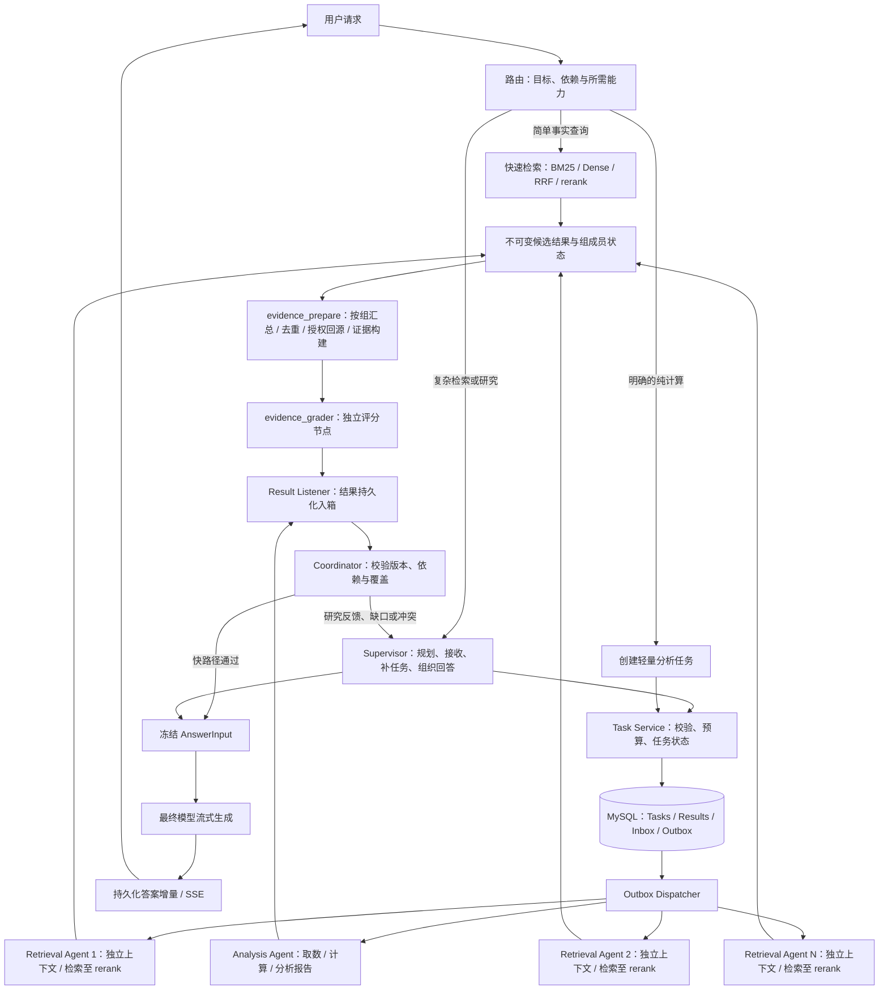
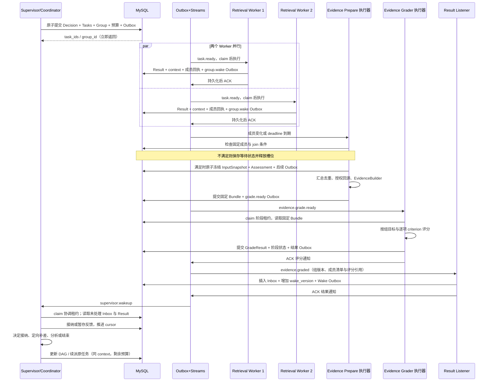

# Supervisor、Retrieval Agent、分析报告 Agent 与可靠任务协作设计

日期：2026-10-30

状态（2026-10-31 更新）：已按用户确认的设计完成核心开发、离线回归及隔离环境中的真实 MySQL / 模型验收，包含并行检索、定向补差、Supervisor 与 checkpoint 恢复、最终答案流式输出。新入口默认关闭；跨主机、高并发及业务语料质量基准验收仍待后续部署工作。具体实现、测试证据、启用和回滚边界见[运行说明](../../supervisor-runtime.md)和[验收记录](../../supervisor-live-validation.md)；以下内容保留为设计合同，不代表全部生产验收已经通过。

设计基线：`998e99c` 的静态源码检查。实际实现范围与验证结果以运行说明和验收记录为准。

语言与框架：沿用 Python、LangGraph、MySQL、Redis Streams、现有检索和 Tool Runtime。

## 1. 调整目标与已确认边界

本次按用户要求调整七点：

1. Evidence grader 保留为独立流程节点：对证据准备节点产出的固定证据版本执行评分，结果反馈 supervisor；替代前一稿的“grader 放入检索 Tool”方案。
2. Retrieval Agent 的检索流水线到 rerank 为止；由 supervisor 指派一个或多个任务，子 Agent 在独立上下文中完成任务并返回局部结论与依据。
3. 增加 Analysis Report Agent（分析报告 Agent，下文简称 Analysis Agent），负责跨证据分析、数据比较、数学计算和结构化报告。数学计算工具只向该 Agent 暴露。
4. 设计任务派发、结果监听、部分完成、超时取消和重启恢复。
5. 目标、输出格式、工具与来源指引、任务边界是派发合同的必填内容，不能只交给子 Agent 一句查询文本。
6. 多个 Retrieval Agent 可以并行执行；evidence_prepare 负责按显式任务组汇总、去重、回源和构建证据，grader 对汇总版本判断覆盖与缺口。
7. 简单事实查询直接进入快速检索，无须先经过 supervisor 规划和子 Agent 派发；证据不足或需要分析时再进入对应路径。

用户进一步确认：覆盖独立 Worker 执行，以及 supervisor 重启后继续接收未完成任务。因此，同进程的 `asyncio` 并行不能作为最终交付边界。

子 Agent 保有自己的任务上下文，提交结论、依据与未解决缺口。定向补差沿用同一逻辑任务的上下文和剩余预算；跨任务范围的变更交给 supervisor。独立 grader 的意见先进入 supervisor 收件箱，再由 supervisor 决定继续、转派或结束，子 Agent 负责局部查询和补差执行。

以下实现选择已随用户授权进入开发与验收：

- supervisor 是唯一全局规划者；子 Agent 可以报告缺口，不自行递归创建其他 Agent。
- 任务控制状态与结果保存在 MySQL；Redis Streams 承担可重投的通知。
- 候选结果逐个持久化；同一检索组按有界等待规则汇总，不同组和已满足依赖的工作独立推进。
- 最终用户正文使用真正的模型 token 流；第一段正文发布前冻结已接受证据与分析结果。
- 检索质量、分析结论校验、最终语言忠实度分开记录，不能统一伪装为 `audited=true`。
- 首版验收覆盖同一部署内多个独立进程、子 Worker 接管、supervisor 重启。跨主机部署还需要共享结果存储与部署验收，不用同机测试宣称跨机高可用。

最初设计阶段仅做静态检查；后续开发与真实调用按用户授权执行，数据库迁移、索引写入和故障注入限于专属测试资源，未迁移或重启业务环境。

## 2. 当前实现与这次变化的关系

| 当前源码 | 已核对行为 | 需要调整 |
|---|---|---|
| `retrieval/graph.py:302` | 七个节点：校验过滤、双路召回、RRF、rerank、Parent 聚合、回源、EvidenceBatch | Agent 内保留检索至 rerank；Parent 聚合、授权回源与证据构建移到外部 evidence_prepare 节点 |
| `query/tools.py:43` | `retrieve_evidence` 返回 batch 和 packed evidence，没有 grader | 检索 Tool 返回 RankedCandidates；独立流程产出 EvidenceGradeResult |
| `runtime/query_composition.py:154` | child worker 只调用一次检索，没有自主局部循环 | 升级为受任务合同约束的 Retrieval Agent |
| `query/subagents.py:153` | 创建 asyncio tasks，以 `asyncio.wait` 等待整批或超时 | 拆成持久化 submit、独立执行、结果入箱、逐项接收 |
| `query/evidence_builder.py:111` | 接收多个 EvidenceBatch，按覆盖目标选材并去重 | 复用构建能力，补齐跨 Worker 的组成员合同、有界汇总与不可变输入清单；现有多 batch 构建不等于已有可靠并行汇总 |
| `query/todos.py:155` | 负责 DAG readiness、claim、完成和阻塞 | 复用纯校验逻辑，状态迁移归持久化任务服务 |
| `query/fast_rag.py:53` | 简单查询已有单次检索、证据构建与 grade；不足时进入 research | 保留直接快路径，与研究路径共用准备和评分逻辑；升级时复用候选、评分与剩余预算 |
| `query/graph.py:246` | Research 结束后统一 grade，再进入 generate | 保留独立 grader 职责，改为对具体检索组的证据版本执行，并将结果交回 supervisor |
| `query/research_loop.py:80`、`query/tools.py:75` | 主循环有 calculator action，ResearchToolset 暴露计算能力 | 新路径将计算入口收口到分析报告 Agent，supervisor 只派发分析任务 |
| `query/audit.py:321` | 整篇草稿生成后进行忠实度与引用审计，可能重新生成 | 改为流式发布合同，不能只移动 evidence grader |
| `runtime/model_gateway.py:133` | `complete` / `complete_structured` 返回完整响应 | 增加真实流式调用、计费和中断语义 |
| `query/public_answer.py:275` | 文档答案要求 `audited=true` | 以版本化 API 区分来源预检与最终文本审核 |
| `api/query_runs.py:249` | 已有持久化事件与 Last-Event-ID SSE 重连 | 增加正文增量、正文版本与终止事件 |
| `persistence/checkpoint.py:26` | SQLite saver 强制每类一个 Worker | 不能让多个独立 Worker 共写这个父图 checkpoint |

以上为源码事实，没有在本轮重复跑业务测试。旧的总体设计与 Todo 设计分别描述原实现；本稿审阅通过后，新路径以本稿为准，旧路径保留为迁移基线。

## 3. 方案比较与选定方向

| 方案 | 优点 | 代价与适用范围 |
|---|---|---|
| 同进程 LangGraph 子图 / asyncio fan-out | 修改较少、调用简单 | 不能覆盖用户已确认的独立 Worker 与可靠结果接收 |
| 持久化任务协议 + 独立 Agent Worker + supervisor 收件箱 | 支持逐项完成、恢复、单独扩容；复用现有 MySQL/Redis | 需要明确状态、租约、幂等、事件与协调事务；本稿推荐 |
| 新增完整外部工作流平台 | 可利用平台的调度和恢复能力 | 引入另一套基础设施和状态模型；当前需求不足以证明必要性 |

用户已选择独立 Worker 与重启恢复的边界。本稿用第二种方案落实；没有把之前的 RabbitMQ 讨论稿视为已批准选型。Broker 接口应允许后续替换，但这次设计默认沿用 Redis Streams。

在 grader 位置上，内置检索 Tool 能减少一次编排往返，独立节点能统一评分规则、独立重试与观测，并让 supervisor 接收明确的评分反馈。本稿按用户最新提议选择独立节点。它是受运行时调度的工作流节点，不必新增一个自治 Grader Agent，也不要求单独部署一个服务。

## 4. 总体架构与职责



| 组件 | 拥有的职责 | 边界 |
|---|---|---|
| Supervisor LLM | 拆任务、选择 Agent、接收评分、决定定向补差或结束、组织回答 | 提出动作，不直接使用数学计算工具，不写任务终态或绕过预算 |
| Task Service / Coordinator | 派发合同与 DAG 校验、检索组成员登记、依赖接纳、预算与并发、快路径接纳、状态迁移 | 确定性代码，不增加一轮调度 LLM；不能把未评分候选接纳为证据 |
| Retrieval Agent | 在独立上下文中制定查询、检索至 rerank、返回检索发现与候选来源；收到续派时定向补差 | 不自评证据充分性，不调用数学计算工具，不跨范围搜索 |
| Evidence Prepare | 按检索组有界汇总多个结果、去重、合并来源关联、授权回源和证据构建 | 不自行决定事实成立，不计算业务指标，不无限等待 Worker |
| Evidence Grader | 对汇总证据检查局部结论支持度、逐目标覆盖与冲突，反馈 supervisor 收件箱 | 不承担全局规划，不计算业务指标，不直接标记任务 accepted |
| Analysis Agent | 在独立上下文中对齐数据、计算、分析、组织报告结论及依据 | 业务数学计算的唯一 Agent 入口；新检索需求由 supervisor 协调 |
| Worker Runtime | 领取任务、续租、执行、持久化结果、取消与重试 | 一个 Worker 进程可执行多个 Agent 任务，Agent 实例不等于进程 |
| Result Listener | 接收通知、可靠入箱、去重与唤醒 | 不进行 LLM 推理，不直接调用正在执行的父图 |
| Final Answer Generator | 基于固定输入流式组织回答 | 同一正文版本中不继续检索、改变证据或静默整篇重写 |

复用同一份编译图和无状态依赖没有问题；每个任务的消息、预算、scope、证据和进度必须隔离。

### 4.1 子 Agent 的私有上下文与统一交付

supervisor 按第 7.1 节提供明确目标、输出格式、工具与来源指引、任务边界，以及必要背景、依赖和预算；不默认复制整段主对话或其他子 Agent 的消息历史。子 Agent 的 `TaskContext` 保存本任务的工具观察、已尝试查询、阶段摘要、证据引用与缺口记录，供后续补差继续使用。

上下文按 `run_id + task_id + task_revision` 隔离，按 `context_version` 保存受限大小的不可变快照；内容通过 Artifact 引用保存，预算账本仍以数据库为准。每次完成检索轮次或分析阶段时，状态、输出和 context_ref 在有效租约下提交。新 Worker 可以加载最近已提交上下文；未提交的一轮可重放，重启不恢复已消费的预算。

对 supervisor 的交付为有界的 `conclusion/findings + basis_refs + gaps + outcome + usage`，不自动把全部原始命中和子 Agent 对话复制进主上下文。原文与工具产物按引用保存，接纳和生成需要时由受权服务读取。检索发现属于待评分的局部结论，不能冒充分析报告或已被验证的业务结论。

### 4.2 简单查询直接走快速检索

快路径适用于目标和主体明确、来源范围已确定、一次检索可回答的事实查找，例如“甲公司 2024 年合并营业收入是多少”。问题字数不是复杂度标准；短句也可能需要多跳、多个来源互证或数学计算。

```text
简单事实查询
  -> 直接调用 Retrieval Tool（BM25 || Dense -> RRF -> rerank）
  -> evidence_prepare（单成员组，立即准备）
  -> evidence_grader
  -> Coordinator 确定性接纳、冻结 AnswerInput
  -> 最终模型 token 流

多目标 / 多跳 / 需要补差的查询
  -> Supervisor -> 一个或多个 Retrieval Agent
  -> evidence_prepare（按组汇总）-> evidence_grader -> Supervisor
  -> 必要时 Analysis Agent -> 冻结 AnswerInput -> 最终模型 token 流
```

快路径不创建自治 Retrieval Agent，也不先做一轮 supervisor 规划。它保留 Run、权限、来源追踪、预算和阶段持久化；与复杂路径共用检索、准备和评分实现。候选统一登记为 `origin=fast_pipeline`，以 fast_execution_id 作为单成员组的来源身份，不伪造 AgentTask。阶段可以在当前受控执行器内顺序执行，无须为了共用合同额外绕一遍子 Agent 队列。

评分仍可靠进入 supervisor 收件箱。快路径的 sufficient 结果由 Coordinator 按预先定义的事实查询合同直接接纳，不为此额外调用 Supervisor LLM。insufficient/conflict 则带着原候选、固定证据包、评分、已尝试查询和剩余预算，升级同一 Run 的 supervisor 流程；可将快路径结果作为已登记成员带入后续检索组，再只派发缺口任务。已有查询不会因切换路径重新免费执行。

主体/时间等目标不明确时进入澄清；服务暂时失败按阶段有限重试，不能把技术失败当作业务证据不足而无限升级搜索。已有数值的纯计算直接进入轻量 Analysis Agent；需要先取数再计算时，取数可用快路径，但计算仍交给 Analysis Agent。

## 5. Retrieval Agent 与 Retrieval Tool

### 5.1 Agent、检索 Tool 与外部评分节点

Retrieval Agent 负责一个局部检索目标，例如“获取甲公司 2024 年与 2023 年、同一合并口径的营业收入与来源”。在自己的上下文中生成查询、处理 supervisor 下发的缺口；Tool 的固定流水线到 rerank 为止，不含 grader 或数学计算。

```text
Supervisor 指派或续派（完整 TaskSpec、缺口、剩余预算、context_ref）
  -> Retrieval Agent 私有上下文
       查询规划 / 定向改写
       -> Retrieval Tool
            权限与检索过滤 -> BM25 || Dense -> RRF -> rerank
            -> RankedCandidates
       -> RetrievalResult（局部发现、候选来源、已执行查询、上下文引用）
  -> evidence_prepare 节点
       按检索组汇总一个或多个 RetrievalResult
       -> 去重与来源关联 -> Parent 聚合 -> 授权回源 -> EvidenceBuilder
       -> PreparedEvidenceBundle
  -> evidence_grader 节点
       检查局部结论支持度、逐目标覆盖与跨结果冲突
       -> EvidenceGradeResult
  -> Supervisor 收件箱
       sufficient：接纳或推进依赖
       insufficient/conflict：按具体缺口与剩余预算决定续派
       clarification_required/unavailable：澄清、有限重试或结束
```

rerank 分数仅表达排序信号，不能替代证据充分性判断。已有 Parent 聚合、授权回源和 EvidenceBuilder 不应删除：它们移到 Agent 外的 evidence_prepare 节点，防止 grader 仅凭命中摘要、ID 或分数判断。该节点保留完整原文、文档版本和定位，并把 candidate 引用映射到稳定 evidence ID。

节点独立是逻辑职责独立，不等于必须独立部署；同一受控执行器可以顺序运行 evidence_prepare 与 evidence_grader，不同检索组的评分可并行。grader 技术失败只重试对应评分阶段，不重新跑 BM25/dense/rerank。

### 5.2 分开的数据合同

| 合同 | 关键内容 |
|---|---|
| `RankedCandidates` | query、child/parent/document/version ID、候选片段、排序分数、scope/index generation、退化标记；不含 grade |
| `RetrievalResult` | task/revision/input_version/round/context_version、局部结论 `findings[]` 及 candidate_refs、候选集合引用/hash、已执行查询、剩余缺口；不含自行宣称 sufficient 的字段 |
| `EvidenceInputSnapshot` | group_id/revision/aggregation_version、不可变 member_manifest/hash；逐成员记录来源身份、精确任务版本/轮次、结果 ref/hash 或未完成状态，以及 criteria_hash、收集截止时间 |
| `PreparedEvidenceBundle` | bundle_id/hash、input_snapshot_ref/hash、原文、manifest、candidate-to-evidence 映射、source_origin_refs/criterion_ids、scope、索引代际、missing_members、覆盖目标与截断记录；来源可以是 Agent 任务或快路径执行，由外部节点构建 |
| `EvidenceGradeResult` | assessment_id、group_id/revision/aggregation_version、input_snapshot_hash、bundle_ref/hash、criteria_hash、grade、collection_completeness、coverage_by_criterion、member_coverage、finding_support、gaps、conflicts、grader/prompt 版本 |

grade 的业务值是 `sufficient / insufficient / conflict / clarification_required`。调用失败为独立的技术状态，不伪装为“文档没有答案”。空命中与“原文明确未披露”也必须区分。

collection_completeness 由运行时依据输入清单中的必需成员状态确定，模型不能把它改写为 complete。grade 描述实际证据对验收项的支持；即使某个子集充分，也必须分别保留未完成成员和未覆盖目标。

每个 gap 至少包含 `criterion_id, related_task_ids, missing_fact, subject, period, scope_or_unit, supporting_evidence_refs, suggested_search_direction`，而不只是“继续检索”。对于超出当前资料能力的缺口也明确标记，不反复改写同一个问题；grader 只提出方向，是否续派、派给谁由 supervisor 决定。

多轮补差时，evidence_prepare 按 supervisor 指定的有效成员与轮次合并候选，保留其他成员已有结果，校验来源与代际，再为新 aggregation_version 生成快照和证据包。grader 对实际构建的完整包重新判断。不得只 grade 新增片段，就沿用旧结论宣布合并包 sufficient。

Grader 检查相关性、主体、时间、指标口径与单位、覆盖、矛盾以及来源定位；不负责计算同比等业务指标。模型判断不替代服务端授权和 manifest 校验，也不等于事实绝对正确。

评分绑定检索组目标、具体成员结果清单和证据内容，不能只绑定“最新一项任务”的 round_id。supervisor 可引用多个通过的包，但删掉必需证据后不能沿用旧覆盖结论；超出生成上下文预算时应选择完整支持单元，或构建并评估新的受控包。

### 5.3 定向补差与预算归属

supervisor 收到评分后，仅把具体 gaps、必要依据引用和 continuation 指令交回原逻辑检索任务。子 Agent 在自己的上下文中知道哪些查询已失败、已有何种证据，再决定具体查询与筛选；不把全部主对话和其他任务上下文带入。

同一合同下的补差增加 `round_id` 与 `context_version`，保持 `task_id/task_revision` 和已耗预算；目标、验收或工具/来源/边界合同变化增加 task_revision，符合原合同的外部输入变化增加 input_version。记录每轮 evidence delta、gap closure 和查询语义指纹，无进展达到上限就返回 partial/blocked，不用新 call_id 或新 Worker 刷新预算。

每个检索任务预算覆盖查询、检索轮数、技术重试、模型 token、deadline 与无进展次数；跨任务的准备/评分预算归检索组，并共同受 Run 总账约束。一次汇总评分只记一次实际消费，不能重复记到 N 个子任务，也不能把外置 grader 当作免费调用。首轮派发及每次续派均原子预留任务预算和该 aggregation_version 的准备/评分额度；不足则不启动这一轮，保留已有结论与缺口。

子 Agent 自主执行局部检索，supervisor 拥有继续、变更范围、转派与停止的控制权；两者不同时为同一个 gap 独立创建补检任务。

### 5.4 多 Agent 并行与证据准备节点的汇总责任

supervisor 派发时显式创建 `RetrievalGroup`：哪些任务为同一目标准备证据、各自覆盖哪些 criterion、哪些成员必需、哪些只是补充，以及 join_deadline。成员列表不能由“当前已返回几个结果”推断。单个 Retrieval Agent 是单成员组；多个并行 Agent 是多成员组；不同组不共用等待屏障。

首版每组至少有一个必需成员，不接受只有 optional 成员却没有明确等待条件的组。同组待执行成员不能依赖本组评分后才可取得的结果；这种多跳依赖必须拆组，否则任务 DAG 即使无环也可能与汇总屏障形成死锁。

evidence_prepare 的持久化收集状态逐项登记候选，未满足汇总条件时释放执行槽位，由新结果或到期事件再次调度。它不占着 Worker 用循环等待其他 Agent；不对每个中间候选立即重复做一次 LLM 评分。

默认汇总规则是：所有必需成员本轮已有成功结果或最终失败/取消状态，或 join_deadline 到达，便冻结一次输入清单；可选成员只收录冻结前已成功返回的结果。join_deadline 不超过 Run deadline，必须为评分、分析与回答预留时间。必需成员缺失/失败不等于任务覆盖完成；部分清单仍可供 grader 判断已有支持，但 `collection_completeness=partial` 必须保留，不能按完整成功解锁依赖。冗余的备选检索应声明为 optional，避免将不必等待的工作错误设为必需。

证据准备节点在固定输入上执行：

1. 校验成员身份、任务修订/输入/轮次、来源权限、文档版本及索引代际。scope 可以是同一授权快照下不同的子范围，但不能扩张权限；跨 scope/代际的输入只有在合同显式允许且逐项校验后才能组合。
2. 合并候选并按稳定来源身份去重；保留一个证据对应的所有 task/criterion/query 关联。相同片段被两个 Agent 命中不算两个独立来源。局部 findings 保留作者任务和来源映射。
3. Parent 聚合、授权回源，保留主体、时间、单位、口径、来源定位和相互冲突的原文；不在汇总时擅自选掉矛盾的一方。
4. 按目标覆盖分配上下文额度，再在各目标内选材。不同 query 的 rerank 分数不直接当成全局可比分数；一项任务大量返回不能挤掉另一必需目标的证据。
5. 生成不可变 PreparedEvidenceBundle、输入清单与未覆盖/被截断记录。仅有 criterion 标签不代表已经支持该目标，最终由独立 grader 判断。

`group_revision` 表示成员或验收合同的修改；`aggregation_version` 表示一次获准收集和评分的版本。每个版本固定预期成员的任务修订、input_version、请求轮次，以及允许沿用的旧结果引用。冻结和成员登记在同一组状态锁下排序，冻结后迟到的结果不能改写旧快照。迟到通知可唤醒协调器，只有组仍有效、未冻结正文且预算允许时，才显式开启下一个汇总版本；不会自动无限重评分。

例如 R甲已提供有效证据、R乙需要补查：保留 R甲的 result_ref，只续派 R乙；下一版本汇总 R甲原结果和 R乙被指定的有效轮次，再重新评分。共享 grade 的接纳原子记录一次组版本和各 criterion 的覆盖；不能把“组通过”批量复制成每个任务 accepted。每项任务只按自身必需 criterion 与成员状态接纳，组内局部 accepted 也不自动表示整个比较目标充分。

如果 A甲确实只依赖甲公司数据并希望提前分析，应将甲、乙设成可独立评分的组，再为跨公司任务声明两个组的依赖；不能一面要求同组完整汇总，一面让未评分的 R甲 候选提前解锁分析。组是证据覆盖和等待边界，不是一次 submit 调用的所有任务。

### 5.5 并发上限与多跳依赖

同一 Agent 类型的多个任务可以并发；每个任务内又有 BM25/dense 并发。这两种并发分别限流，不能因为开了三个 Agent 就放大三倍无限制模型或 rerank 并发。

多跳中，上游结果先被接纳，再把精确的 `result_ref + input_version` 绑定到下游。查询中的主体不由字符串拼接默认猜测。独立任务允许并行，存在依赖的任务只在依赖合同满足后执行；后续 hop 使用新检索组或明确的新组修订，不能暗中加入已经冻结的成员清单。

## 6. Analysis Report Agent（分析报告 Agent）

输入为具体分析目标、已接纳的证据包引用、允许的计算/读取工具、分析口径和预算。首版分析能力覆盖：

- 主体、年份、币种、单位、合并/单体口径的一致性检查。
- 表格或结构化事实提取，保留原始单元格/行列证据。
- 比率、同比、差额、排序和趋势等确定性计算。
- 跨文档比较、冲突说明、关联与因果的区分。
- 输出证据支持的发现、带前提的推断和无法完成的部分。

数学计算统一由分析报告 Agent 调用受控计算工具完成，包括简单算术、同比、比率、差额和汇总。supervisor、Retrieval Agent 与 evidence grader 的工具 allowlist 不提供 calculator；简单计算可直接创建轻量分析任务，没有外部事实依赖时不必先检索。检索流程内部的排序分数计算属于算法实现，不属于这个业务工具边界。

该限制由 Tool Runtime 基于服务端 agent_role 校验，不能只依靠 prompt，也不能通过通用 discover/call_tool 绕过。用户在请求中明确给出的数值可以作为有来源标记的 task input，计算结果引用该输入，不伪造文档 evidence ID；计算正确只说明给定输入与公式得到该结果，不证明输入本身的业务真实性。

分析 Agent 返回面向任务的报告结论、解释、计算结果及依据；面向用户的综合回答仍由 supervisor 汇总并流式输出。任意 SQL、任意宿主 Python 执行与开放网络访问不是本稿默认授权的工具能力。

`AnalysisResult` 包含：

```text
report_summary, report_sections[]
findings[]:
  claim_id, statement, kind=fact|calculation|inference
  evidence_refs[], calculation_refs[], assumptions[], limitations[]
calculations[]:
  formula, operands(value/unit/period/subject/source_locator), result, rounding
consistency_checks[], conflicts[], missing_inputs[]
conclusion_assessment_ref, input_bundle_hashes[], coverage[]
outcome=complete|partial|needs_input|conflict|unavailable
```

分析内部的结论校验检查“结果是否由输入支持”，与检索后独立 evidence_grader 节点的职责不同。确定性检查负责计算和引用归属；语义校验检查归因与推断边界，保留不确定性，不能宣称校验杜绝幻觉。

分析 Agent 在自己的上下文中先使用已有证据定向取数、核对口径、补充计算，受同一任务预算约束。需要新文档证据时返回 `needs_input` 和结构化缺口，结束本次 attempt、释放 Worker 槽位；supervisor 委派 Retrieval Agent，经过独立 grader 后把新增证据交回原分析任务。分析上下文保留已验证的结果，新增输入有明确版本，不从头重复所有计算。

补充资料绑定该分析任务的新 input_version；只有目标或验收条件改变时才增加 task_revision。旧输入版本的分析结果不能覆盖新版本；上下文中依赖被替换来源的事实与计算必须失效，只有仍适用于新输入的结果可以复用。DAG 修改需重新验环，补检只接收已持久化的 gap 描述与事实引用，不能等待分析 A 的最终报告而让 A 反过来等待补检任务。

## 7. 任务、执行与结果合同

### 7.1 派发任务必须包含的内容

TaskSpec 是明确的委托合同，不是一条让子 Agent 自由发挥的 prompt。四项内容必须显式给出：

| 必填部分 | 合同内容 | 执行约束 |
|---|---|---|
| `objective + acceptance_criteria` | 要回答什么、主体/期间/指标、为什么需要该结果，以及可逐项判断的 criterion_id | 不使用“调查一下该公司”作为完整目标；验收以具体目标覆盖为准 |
| `output_contract` | 服务端登记的 schema_id/version、必需字段、结论与依据的对应方式、缺口和部分结果格式、长度上限 | 检索返回局部发现和候选引用；分析返回报告结论、计算与来源；结构不符时有限修复或明确失败 |
| `tool_guidance + source_guidance` | 可用工具、优先策略与允许的降级方式；指定资料/文档集合、来源优先级、时间范围和定位要求 | 区分 must_use/allowed 与 preferred；偏好不能覆盖权限和工具能力，必需来源不可用时报告缺口 |
| `task_boundary` | in_scope、excluded_scope、允许自主调整的范围、停止条件、需交回 supervisor 的事项 | 约束目标扩张、Agent 间调用及补差；同一目标内可改写查询，扩大主体/时间/来源必须回报 |

同时提供必要背景、依赖的精确结果版本、context_ref、所属检索组及 criterion 分工、预算和绝对 deadline。模型可提出预算分配，身份、权限上限、实际可用工具和预算预留由服务器确定；不能由任务文字自行授予权限。

例如派给 R甲 的合同为：

```text
目标：
  查明甲公司 2023/2024 年合并营业收入及年报对 2024 年变动的说明。
  验收项 C甲23、C甲24、C甲原因分别要求可定位的来源。
输出：
  RetrievalResult.v1；逐项给出局部发现、候选引用、主体、期间、
  指标、原始数值、单位/币种、合并口径；找不到的项列入 gaps。
工具与来源：
  允许 Retrieval Tool；优先已授权的甲公司 2024 年年报及其比较数据。
  需要补充时查允许范围内的 2023 年年报；保留文档版本和页/表/行位置。
  来源优先级不能扩大到未授权资料，也不能把搜索摘要当原始披露。
边界：
  只收集甲公司事实与原文解释，不计算同比、不分析乙公司。
  可在剩余预算内改写查询；缺口经 grader 反馈后按 supervisor 续派补查。
  无进展、超预算或发现目标/来源范围需改变时交回缺口与已有发现。
协作：
  group=G收入比较，负责 C甲23/C甲24/C甲原因；
  context 和已耗预算沿用本逻辑任务，输出不包含全部私有对话。
```

运行时检查四部分是否完整、schema 是否可验证、来源要求是否与权限相容、工具是否属于对应 Agent 角色、边界是否与目标冲突。不合格则返回结构化合同错误让 supervisor 修正，不以一个宽泛默认任务静默执行。来源与边界中的硬限制必须编译到工具参数和服务端校验，不能只写在提示词里。

工具/来源偏好和边界随任务修订冻结，变更这些内容或目标/验收条件时增加 task_revision；仅补充符合原合同的新输入则增加 input_version，预算内补差则增加 round_id。快路径由路由运行时构造等价的事实目标、输出和来源约束，不需要为了填表再调用一次规划模型。

### 7.2 持久化实体

| 实体 | 关键字段与责任 |
|---|---|
| `AgentTask` | `run_id, task_id, agent_type, task_spec_ref/hash, objective, output_contract, tool_guidance, source_guidance, task_boundary, task_revision, input_version, round_id, context_ref/version, created_in_plan_version, dependencies, criteria, required_for_answer, state, acceptance_status, scope_ref, snapshot_id, index_generation, budget` |
| `RetrievalGroup` | `group_id, group_revision, aggregation_version, criteria, expected_members, retained_result_refs, required_members, join_deadline, collection_state, scope_ref, budget`；显式登记等待范围、成员状态和一次汇总的准备/评分额度 |
| `FastRetrievalExecution` | `fast_execution_id, run_id, input_contract_ref, stage_state, candidate_result_ref, group_ref, budget`；快速检索的直接执行记录，不冒充 AgentTask |
| `TaskAttempt` | `attempt_id, execution_subject_ref, stage_type, round_or_aggregation_version, execution_attempt, owner, lease_token, lease_until, dispatch_generation, started_at, deadline_at, error_code`；执行主体为任务、组或 fast execution，阶段重试与业务补差分开计数 |
| `TaskResult` | `result_id, task_id, task_revision, input_version, round_id, attempt_id, artifact_ref/hash, context_ref, conclusion/findings, basis_refs, gaps, outcome, usage`；不可变 |
| `CandidateResult` | `result_id, origin, origin_ref/version, artifact_ref/hash, candidate_refs, findings, queries, usage`；origin 为 agent_task 或 fast_pipeline，统一引用两类检索结果并保持真实来源身份 |
| `EvidenceInputSnapshot` | `snapshot_id, group_id/revision/aggregation_version, member_manifest_ref/hash, criteria_hash, frozen_at`；包含精确成员结果版本、缺失/失败状态与复用的历史结果，不可原地追加 |
| `EvidenceAssessment` | `assessment_id, group_id/revision/aggregation_version, input_snapshot_ref/hash, criteria_hash, prepare_status, grade_status, prepared_bundle_ref/hash, grade_result_ref, attempts, budget_reservation`；独立准备/评分阶段，可单独重试 |
| `TaskContextSnapshot` | `context_id, context_version, artifact_ref/hash, owning_task_revision`；子 Agent 私有上下文的已提交版本 |
| `TaskOutbox` | 任务就绪、结果可用、取消、唤醒等持久化通知意图；发布可重试 |
| `SupervisorInbox` | `run_id, inbox_seq, event_id, result_id, received_at, disposition`；按 event_id 唯一去重 |
| `RunCoordinationState` | `state_version, plan_version, plan, accepted_results, pending_semantic_results, applied_inbox_seq, phase, deadline_at, budget, wake_version`；协调事实源 |
| `SupervisorDecision` | `decision_id, input_state_version, input_hash, model_action, commit_status`；记录已采纳决策与幂等命令 |
| `AnswerStream` / `AnswerChunk` | `run_id, answer_epoch, seq, status, input_manifest_ref, content`；正文可恢复发布记录 |

TaskSpec、组合同与对应输入版本由可信存储回查；身份、租约、时间、版本与预算上限由服务器注入。任务和组各自修订，不能原地改写正在执行的合同。

plan_version 用于全局计划修订；有效性按 task_revision 与 input_version 判断。仅追加不相关任务不会使已有任务全部失效。重规划明确标记被替换的任务，并使其依赖分析失效。

### 7.3 执行完成与结果接纳

```text
逻辑检索任务：ready -> retrieving -> waiting_group -> waiting_grade -> waiting_feedback
              ^                                                         |
              |-- 续派：round_id + 1，沿用上下文与剩余预算 -----------------|
                                                                        |-> completed / blocked

检索组某一版本：collecting -> snapshot_frozen -> preparing -> grading -> feedback_ready
               未到汇总条件时持久化等待；补差显式开启下一 aggregation_version

阶段执行：queued -> running -> succeeded
                        |-> retry_wait -> queued（新 attempt，同一 round）
                        |-> failed / timed_out / cancelled

分析任务：ready -> analyzing -> completed
                      |-> waiting_input -> ready（新 input_version）

结果接纳：pending -> accepted | partial | rejected
```

阶段 `succeeded` 只表示本次检索、评分或分析执行产出结果。RetrievalResult 到达后进入 waiting_group，组输入冻结并进入准备/评分后为 waiting_grade，均不能解锁下游；评分提交后进入 waiting_feedback，只有接纳动作才能完成任务。快速检索使用同样的组阶段状态，但不创建逻辑 AgentTask。grade insufficient、事实口径冲突属于正常业务反馈，预算内可定向续派；预算耗尽等条件使任务 blocked 并交付已有结论与缺口。

上述任务阶段适用于本轮新执行的成员。已经接纳并完成的任务在后续组版本中只复用不可变 result_ref，不退回 waiting_group 或重新领取 Worker；新组的覆盖与接纳仍单独记录，不能继承旧组的 sufficient。

依赖默认要求指定输入版本的 `accepted` 结果；允许 partial 的分析任务必须在输入合同中显式声明哪些缺口可容忍。失败与取消不得伪装成业务成功。可重试失败保留 attempt 历史，不把任务整体终态改回 running。

### 7.4 指派接口

supervisor 提出 `submit_tasks(task_specs, retrieval_groups, expected_state_version, decision_id)`，运行时按顺序验证：

1. 目标、输出格式、工具与来源指引、任务边界四项完整；Agent 类型、schema、参数大小与角色工具 allowlist 合法。
2. 用户范围、文档范围、配置与索引代际，且只能收窄权限。
3. DAG 无环、依赖版本正确、结果合同可检查；组成员/criterion 分工明确、汇总截止时间合法，至少一项必需成员；成员无须等待本组评分才能执行，防止任务依赖与 join 组合死锁。
4. Run 有效、未取消、未进入正文冻结阶段、未超 deadline。
5. 总任务数、最大深度、执行次数、并发槽位与 token/成本预算可预留。
6. 以 `decision_id + command_index` 唯一键原子创建任务、组合同、预算预留与 Outbox；批量请求的临时成员键在同一事务内映射到正式 task_id。

返回任务 ID 与持久化状态，不等待任务结果。运行时负责启动已经批准且依赖满足的任务；每个就绪任务不必再问一次 LLM。

若以模型 tool calling 暴露接口，`submit_tasks` 对应的 tool result 只返回提交回执。稍后收到的任务结果作为新的结构化 observation 加入下一轮上下文，不能对同一个 tool_call_id 追加第二个结果。`wait_for_tasks` 只登记等待条件（指定依赖、任一结果或所有必需结果）并让出协调执行；`cancel_tasks` 提交取消意图。状态查询用于用户查看和恢复诊断，不作为主模型持续轮询手段。

幂等键防止同一决策重放；语义指纹和 evidence/goal delta 负责识别新 ID 下的重复无进展任务。这两类检查不能互相替代。

## 8. 派发、监听与接收协议

### 8.1 消息拓扑

新增逻辑流：`agenticrag:tasks:retrieval`、`agenticrag:tasks:analysis`、`agenticrag:evidence-assessments`、`agenticrag:task-results`、`agenticrag:supervisor-wakeups`。每类执行器使用竞争消费组；evidence-assessments 按 stage_type 调度收集、准备和评分节点，可由共享 Worker 池执行；Result Listener 消费完成的评分/分析反馈并写持久化收件箱。

同一 consumer group 是负载均衡，不是向每个 supervisor 广播。任何 Listener 都可按 run_id 写入目标收件箱；后续 coordinator 按 Run 执行权领取处理。

消息只携带 `schema_version, event_id, run_id, task/group/assessment/result_ref, dispatch_generation, trace_id` 等定位信息。权限、prompt、正文和凭证从可信存储回查；不依赖消息中的 scope 声明。组成员返回、成员最终失败和 join_deadline 到期均有持久化唤醒责任，不能只监听成功结果。

### 8.2 多个检索任务的一次汇总时间线



必须原子的提交包括：任务/组/预算与派发意图；检索轮次结果、上下文版本、组成员回执与收集唤醒；输入快照与准备阶段派发意图；准备产物与评分派发意图；评分结果与反馈通知；收件箱与唤醒意图。大产物先写入不可变 Artifact，完成校验后再提交数据库引用，不能发布指向半写入产物的事件。分析结果直接以报告/依据合同进入相同结果通知链路。ACK 只发生在相应持久化责任已经建立之后。

evidence_prepare 的已提交产物可由 grader 重试复用；Artifact 未提交完成不得推进 grade 状态。Assessment 按 `group_id + group_revision + aggregation_version` 唯一，绑定 input_snapshot_hash、criteria_hash 和实际 bundle_hash；清单包含每个成员的任务修订、输入版本、轮次及结果 hash。重复 group.wake 不能冻结第二份清单或发起第二次独立评分；迟到的旧组/轮次评分不能覆盖当前版本或解锁分析。

快路径的单成员候选提交后立即满足 join 条件；同一执行器可以连续调用准备/评分阶段，但每个阶段仍按上述合同提交并可恢复。升级复杂路径时，路由转换、已有结果登记、剩余预算沿用与 supervisor 唤醒在同一协调事务完成，避免快路径和研究路径同时继续生成。

同一 Run 的 inbox_seq 在锁定该 Run 的收件箱计数行后分配，并与 Inbox 插入同事务提交。不得用并发事务取得的全局自增 ID 推断提交顺序，否则可能先处理较大 ID、再遗漏较小但晚提交的事件。Run、task、attempt 与协调行使用固定加锁顺序，避免取消、结果提交和接纳相互死锁；网络请求和模型调用始终在事务外。

### 8.3 谁在监听，何时唤醒 LLM

“监听”由常驻 Result Listener 和 Coordinator Runtime 完成。Supervisor LLM 没有常驻循环，也不以模型调用轮询状态。

建议唤醒模型的条件：复杂路径的初始规划、grader 的缺口/冲突需要定向续派、结果需要重规划/澄清、分析缺口需要新检索任务、关键阶段失败需要替代方案。候选就绪先触发组收集，满足 join 条件后才准备/评分，不为每个未评分候选增加一轮主模型；heartbeat、排队进度和重复通知只更新运行状态。所有评分都进入 supervisor 收件箱；相近时间到达的独立组评分可合并到一次模型决策。快路径通过或固定计划已满足输出条件时，可以直接确定性冻结输入并启动最终生成。

如果计划已明确“G1 评分通过且 R1/R2 所需 criterion 均接纳后执行 A1”，Coordinator 可确定性地启动 A1，不增加 LLM 决策。候选先完成就先持久化，但同组必须满足已声明的汇总/评分合同。不同组互不等待；下游按自己显式依赖的结果版本和覆盖启动，不以整个 submit 批次作为屏障。

同一 Run 同时只有一个有效协调租约；其他唤醒合并为 `wake_version` 的变化。模型调用期间不持有 SQL 行锁；调用前记录输入版本，提交时再次检查租约、Run 状态和版本，过期输出不执行。

没有可做工作时，持久化 waiting 状态，释放协调执行槽位。退出前在事务中比较已经处理的 wake_version、收件箱水位和等待条件；若有新结果就保留下一次唤醒责任。这样结果在“准备等待”的窗口到达也不会永久睡眠。

### 8.4 结果接收分为技术校验和语义决策

Listener 只确认通知格式、结果存在和归属，不因模型自报 sufficient 就接纳任务。Coordinator 读取不可变结果，校验：

- run/组/任务/attempt 对应关系、组修订与汇总版本、成员的任务修订/输入/轮次、context_version、发布时有效租约与 payload hash。
- server scope、index generation、artifact 可访问性、引用与 manifest 完整性。
- 独立 grade/analysis assessment 绑定实际输入清单和 bundle；完整组接纳要求全部必需成员与 criteria 满足。部分组只能按下游合同显式允许的成员/criterion 子集接纳并携带限制，不能冒充完整组通过；候选 result 本身不具备接纳资格。
- 结果是否在本次计划中仍被需要；是否晚于取消、替换或答案冻结。

接受或拒绝结果、更新依赖 ready frontier、推进 `applied_inbox_seq` 和写入后续 Outbox 在同一协调事务提交。大正文放在不可变、可授权读取的 Artifact，收件箱仅保留引用。

如需要 LLM 判断新的业务关系，先把结果标记为待语义决策；不能在 SQL 事务中等待模型。模型产出的接纳/重规划动作还要经过确定性校验。

收件箱 cursor 表示事件已归约到持久化协调状态，不表示对应任务已经 accepted。需要后续模型决策的结果必须原子写入 `pending_semantic_results` 后才能推进 cursor，重启后仍会触发处理。

## 9. 重启恢复、租约与 LangGraph 边界

### 9.1 明确协调事实源

新路径以 MySQL 的任务、结果、协调状态和已提交决策为恢复事实源。LangGraph 承载 supervisor 单次决策与 Agent 内部工作流，不把多个 Worker 的 Python 对象或共同可变 State 当作共享内存。

推荐首版把 supervisor 调用做成有界的一次决策：加载 `RunCoordinationState` -> 构造上下文 -> 取得或重用决策 -> 提交经过校验的命令 -> 返回。无事件时不让 Graph 节点永久挂起。一个 SQL `SupervisorDecision` 只允许对应一组已提交命令。

新协调路径的 SQL 状态日志承担应用层持久化；独立调用的 supervisor 决策图和子 Agent 图显式选择 `checkpointer=False`，不假定 `checkpointer=None` 等于无保存，也不让远端子任务继承父 SQLite saver。旧 QueryGraph 的 SQLite 路径作为旧版本独立保留。

恢复粒度需如实描述：已提交检索轮次、上下文快照、组成员回执、汇总输入快照、准备与评分结果分别可复用；快路径也保存同样的阶段结果。已提交 supervisor 命令不重复产生任务。某阶段在结果提交前崩溃，可以重放该有界 attempt，模型请求可能重复；评分失败不重放已经提交的检索。首版不承诺恢复到 BM25 或某次模型 token 的精确中间位置。若以后需要 Agent 内部细粒度恢复，再为 task 配置独立持久化 saver，并保证 `aput` 与 `aput_writes` 同样受执行租约约束。

这是明确的编排调整，不能只是给现有 `SubagentDispatcher` 换成 MQ 后继续让旧 QueryWorker 长时间占有整段 Run。Run 生命周期与协调/任务执行租约需分离。

### 9.2 重启时的动作

1. 从数据库恢复非终态 Run、待处理 Inbox、未发布 Outbox 和执行租约。
2. 对未接纳结果重新接收；已处理 inbox_seq 不重复推进计划。
3. 取回已提交 Decision，不重新派发其命令；模型返回但未提交的决策允许重算。
4. 为过期执行阶段租约安排新的 attempt 与通知代际；未过期阶段继续等待。waiting_group 从持久化成员回执继续收集或触发原 join_deadline；waiting_grade 从固定输入/证据包恢复准备或评分；waiting_feedback 从已提交评分恢复 supervisor 接收。续派恢复原私有 context_ref，不能重新收集整个已冻结组。
5. 保留原来的运行 deadline、预算消费、任务修订和取消请求。
6. 正文流已经开始时按第 10 节恢复发布状态，不重新从头生成并拼到旧正文后。

各 Worker 的 Claim/续租/结果提交以数据库时间和单调 lease_token 判断执行权。旧 Worker 暂停后恢复，不能覆盖新结果、写入正文或发布已接受 Artifact。

### 9.3 至少一次投递的边界

相同 Outbox 事件重发保持 event_id；业务重试生成新 attempt 和 dispatch_generation。消息重投不等于新业务执行次数。Claim 后才计执行预算。

claim 结果区分 claimed、terminal、busy、stale_dispatch、not_due、unknown。terminal 与已有恢复责任的 stale 通知可 ACK；busy/not_due 只有在数据库记录和 Recovery Scheduler 保证后续可唤醒时才 ACK；数据库不可用则暂停/退避，不能宣称处理完成。

Recovery Scheduler 对账：未投递任务、过期租约、到期重试、候选/成员终态已有但组未获唤醒、到期或满足 join 条件却未冻结的组、快照已冻结但准备未派发、准备完成但 grade 未完成、评分/分析结果已有但无 Inbox、Inbox 未处理但无唤醒责任。快路径由其执行记录恢复，不重新创建同义子 Agent 任务。未知/坏消息可靠隔离并告警，禁止无限重投。

结果、状态、接纳和正文发布可以幂等；外部模型调用不承诺 exactly-once。以真实多进程故障注入证明恢复，不能只用单进程 mock。

## 10. 真正的最终答案流式输出

### 10.1 独立 evidence grader 与最终 token 流的关系

grader 独立成节点并不妨碍流式生成：它在每个汇总证据版本准备后、最终正文生成前完成评分，反馈 supervisor 做补差或接纳；简单查询由 Coordinator 直接处理通过的评分。是否能实时发布正文取决于生成后的发布门禁；当前代码中的整篇 faithfulness/citation 审计和 `PublicAnswer.audited` 合同仍需调整。证据评分无法审核尚未生成的最终措辞。

本稿为满足用户目标，建议采用：**检索后按组汇总并独立评分 + 按需分析报告 + 固定 AnswerInput + 最终 token 流 + 明确的输出审核状态**。主流程可以按受预算约束的汇总版本进入 evidence_grader，但不在正文生成后设置统一 evidence-grader 发布门禁；也不把整篇生成后切成小块冒充模型流式生成。

如果仍要求“每段给用户看的自然语言都先通过语义审核”，只能使用先审核后发布的句段流，或者完整草稿审核后展示；这会改变首字延迟与输出保证。本稿没有擅自把该模式作为默认。

### 10.2 开始正文的条件

supervisor 提交 `prepare_answer`，或快路径按固定合同触发同一 gate；确定性校验核对必需任务/组和 criterion 覆盖、引用归属、未解决冲突、预算及取消状态，然后冻结：

```text
AnswerInput:
  run_id, answer_epoch, plan_version, source_result_ids[]
  accepted_group_versions[], input_snapshot_hashes[], assessment_refs[]
  accepted_facts[], accepted_analysis_claims[], inference_labels[]
  evidence_manifest, selected_source_hashes[], unresolved_limitations[]
  authorization_revision, snapshot_id, input_hash
```

跨公司比较、跨表计算等新的分析结论必须来自 AnalysisResult，不能靠所有局部 grade=sufficient 推导出全局答案正确。简单事实查找可跳过 Analysis Agent 和 supervisor 规划，由最终生成器组织已经支持的事实；只要涉及新的业务数学计算，即使公式简单，也派发给分析报告 Agent。

冻结后取消或封存不再需要的可选任务，禁止新结果修改当前 AnswerInput。已入箱且与必需目标有关的结果应先处理；可选迟到结果留作诊断，不能偷偷改变当前正文。未解决的关键缺口触发补任务、澄清或明确的有限回答。

### 10.3 发布合同与审核状态

最终生成器只允许基于冻结输入组织表达；这条约束不能在数学上保证模型不增加事实。输出状态至少拆成：

- `evidence_assessment`: passed / partial / failed。
- `analysis_assessment`: passed / partial / not_applicable。
- `answer_faithfulness`: pending / passed / failed / unavailable。
- `stream_status`: streaming / completed / interrupted / cancelled。

本稿建议保留流结束后的独立文本质量检查，用于更新 answer_faithfulness、质量告警与纠错记录，不阻塞已经发生的 token 发布。它不承担末端 evidence grader 的覆盖决策，也不能撤回用户已经看到的字。失败时明确标记本条答案存在质量问题；需要修订必须创建新的 answer_epoch，不静默替换。

新 API 用版本化的答案结构表达上述状态，旧客户端的 `audited=true` 契约继续只用于旧路径。正文完成与质量检查完成是两个事件；质量检查有独立、有限超时和 unavailable 状态，不能让 Run 无限等待。

建议把 Run 的最后阶段设为 `phase=finalizing`：`ANSWER_COMPLETED` 只表示正文完成，提交它时同时持久化该 epoch 的质量检查待办；Generation/Finalization Runtime 执行检查，Recovery Scheduler 可以接管此待办。检查结束或超时后提交 `ANSWER_QUALITY_UPDATED` 与 Run 终态，客户端在这之前继续接收事件。超时不超过 Run 剩余 deadline，并记录 unavailable。质量失败属于已完成执行的质量结果；生成流因技术错误中断则 Run failed，用户取消则 Run cancelled。SSE 只在 Run 终态且持久化事件已读完后关闭，不能因正文完成而遗漏质量结果。

引用 ID 由冻结 manifest 限定，引用标记完成后再发送结构化 citation 事件，不能把模型生成的任意 ID/URL 当成有效来源。访问权在冻结和发布窗口复核；撤权后停止后续发送和重放。已披露内容无法事后收回，这是 token 流的实际边界。

### 10.4 SSE、持久化与流中断

新增事件：`ANSWER_STARTED`、`ANSWER_DELTA`、`ANSWER_CITATION`、`ANSWER_COMPLETED`、`ANSWER_INTERRUPTED`、`ANSWER_CANCELLED`、`ANSWER_QUALITY_UPDATED`。

每段含 `run_id, answer_epoch, seq`。流式网关将模型增量按短时间或大小窗口合批，先提交 AnswerChunk，再让 SSE 读取发布；不要求每 token 一次 SQL。答案正文存入专用输出存储，不塞进会被清洗截断的 observability summary。

每个 epoch 只有一个有效生成租约。增量、citation 和终止事件写入时都检查当前 epoch、owner/token、Run 取消状态并分配连续 seq；唯一键阻止重放插入。取消提交后不再接受新 chunk，已经在网络中传输的内容不能撤回。质量检查只允许更新自己绑定的 epoch。

- 浏览器断线：后台继续执行；按 Last-Event-ID 和正文 seq 重放，前端去重。
- 生成 Worker 崩溃或 provider 中断：已持久化内容可重放；当前 epoch 标记 interrupted，不自动重复整次请求后拼接正文。
- 可以重试时创建新 epoch，前端明确替换/展示修订，不把新旧两次生成混成一次连续响应。
- 只有 provider 正常结束且最终输出状态持久化成功才记 ANSWER_COMPLETED；SSE EOF 不表示完成。
- 仅把最终生成器的输出写入正文流，planner、grader、Analysis Agent 的内部模型内容不进入用户答案。

现有 complete/complete_structured 的“出错整次重试”策略不能直接复用于已发布 token 的调用。预算、usage、取消和连接清理要覆盖流式路径。

## 11. 一个完整业务例子

用户问：“比较甲、乙公司 2024 年收入增长情况，并分析增长差异的原因。”

1. supervisor 创建 R甲、R乙 和 G收入比较。每项任务有明确目标、RetrievalResult 输出合同、年报来源/工具指引及“收集事实、不计算同比”的边界；组合同指定两者为必需成员及各自 criterion。
2. 两个 Retrieval Agent 在自己的上下文中并行检索。R甲先返回候选、局部发现与 context_ref；结果立即持久化，evidence_prepare 登记 R甲 已返回，释放槽位继续等 R乙 或组 deadline。
3. R乙返回后，evidence_prepare 汇总两份候选，合并重复来源和 task/criterion 关联，授权回源并生成 G收入比较.v1 证据包。grader 发现乙公司数据混用了单体和合并口径，反馈“缺少 2023 年合并口径收入”；甲公司的覆盖单独保留，不被乙的缺口抹掉。
4. supervisor 在剩余预算内只续派 R乙，开启组的下一 aggregation_version，固定保留 R甲 result_ref。R乙加载旧上下文，只补查缺失口径；证据准备节点汇总指定的旧结果和新增结果，grader 重新检查整个新包。失败时交付部分结果与缺口，不宣称完成比较。
5. 双方必需事实与解释接纳后，启动 A比较；派发合同明确报告字段、比较口径、可用计算工具和因果判断边界。它通过计算工具求同比，引用每个操作数的来源；supervisor、检索 Agent 和 grader 都不另行计算。年报仅说“销量增长”时不能擅自断言“价格上涨导致增长”。
6. supervisor 接收分析报告的结论与依据，冻结证据和分析结果，最终模型开始 token 流式回答。
7. supervisor 若在第 2 步后重启，R乙候选仍可持久化并触发组汇总，评分仍由 Listener 可靠入箱；恢复后从组状态和收件箱继续，不重跑 R甲。若 R乙超时，按 deadline 形成带缺失成员的部分包，由 supervisor 选择补差或有限回答。

若用户只问“甲公司 2024 年营业收入是多少”，直接走快速检索、单成员证据准备、独立评分和最终流式输出，无须先创建上述两个任务或调用规划模型。若目标是分别尽早给出两家公司独立报告，则显式设置两个可独立评分的组；这与本例的共同比较组是不同的依赖合同。

## 12. 失败、取消、预算与观测

| 场景 | 必须发生的行为 |
|---|---|
| 派发提交后 Broker 不可用 | Outbox 保留；恢复后投递 |
| 目标/输出/指引/边界缺失或彼此冲突 | 返回明确合同校验错误；不派发一个默认宽泛任务 |
| Worker 完成后 supervisor 不在线 | 候选、评分与分析结果按阶段保留；Inbox 可独立接收评分/分析反馈 |
| R1 返回、R2 仍在执行 | 持久化成员回执并释放槽位；按组成员合同等待，超时可恢复 |
| 两个 Agent 命中相同片段 | 证据去重，保留所有任务/criterion 关联；不虚增独立来源数 |
| 组 deadline 与最后结果并发到达 | 同一组状态锁确定该结果是否属于冻结清单；不会出现两份同版本快照 |
| 候选已保存但 grader 失败 | 只重试评分阶段；保留候选与 context_ref，不重复检索 |
| 新补差轮次运行时旧评分迟到 | 通过组版本、成员清单与 bundle hash 拒绝过期反馈，不覆盖新的缺口状态 |
| 重复/乱序结果 | event_id 去重；任务版本和 inbox_seq 决定处理，不能重复启动分析 |
| A 返回、B 超时 | 保留 A，组快照明确 B 缺失；只重试/替换 B，或对有支持的子集明确部分接纳；不把整个组当成功 |
| 旧 Worker 租约失效后返回 | 条件提交拒绝；不能覆盖新结果或使任务完成 |
| 用户取消与完成竞争 | 同一数据库状态检查确定唯一结果；取消后禁止新派发与正文发布 |
| Agent 报告 needs_input | 释放 Worker；记录缺口；不持槽等待补检 |
| 补检无新证据 | 语义重复与无进展计数触发停止；新 round/call_id/Worker 不重置预算 |
| 任务依赖被替换 | 旧下游结果失效；新版本依赖显式绑定 |
| 快路径评分不足 | 同一 Run 升级 supervisor，复用候选/评分和剩余预算，只针对缺口派发 |
| 快路径已通过后收到旧升级通知 | 由 route/state 版本和正文冻结状态拒绝，不同时启动第二条回答路径 |
| Provider 流中断 | 保留前缀、标记 interrupted，不把重复生成拼接 |

Deadline 存为服务器确定的 UTC 时刻并由 DB 时间验证。现有进程内 monotonic deadline 不能直接跨进程序列化使用；每个进程根据持久化剩余时间建立本地计时器。排队、重试、LLM、检索、分析和收尾都在有限预算内，接管不得刷新总 deadline。

预算包括 Run 总任务数、模型轮次/调用成本、每任务补差轮次、各阶段技术重试、独立评分调用、每任务查询次数、无进展次数、全局与每租户并发。运行前原子预留、结束后结算；查询记到任务/fast execution，准备与评分记到组，各项共同消耗 Run 总额度且一次实际调用只计一次。补差、路径升级或重启不重新发放初始预算。单进程 semaphore 不能表示跨 Worker 的全局限额。子任务并行上限可先沿用当前默认 3，最终参数由基准测量确定。

关键指标：合同校验失败率、任务排队时间、各 Agent 执行时间、组等待/准备时间、必需成员超时率、逐 criterion 覆盖、重复候选比例、快路径占比与升级率、收件箱延迟、唤醒到决策延迟、Outbox 年龄、过期结果拒绝数、重复派发数、补检率、grade sufficient 的人工正确率、分析计算正确率、引用准确率、最终答案正确率、首个正文 token 延迟、质量检查失败率、每 Run 成本。快路径和复杂路径分别统计延迟与质量，避免平均值掩盖退化。

## 13. 实施分段与迁移回退建议

这是设计中的交付分段，不是已批准的实施计划。

1. **明确派发和证据合同。** 固定四项必填 TaskSpec；检索 Tool 截止 rerank，返回 RankedCandidates；设计组成员清单、汇总快照和按 criterion 的评分合同；外置 evidence_prepare 与 evidence_grader。
2. **持久化协作与快路径。** 新增 Task/Group/FastExecution/Attempt/Result/Snapshot/Assessment/Context/Inbox/Outbox/协调状态；实现独立检索 Worker、并行汇总与有界等待、Listener、Recovery Scheduler，以及携带 gaps 的上下文续派。保留简单查询直达检索，复用准备/评分节点，实现升级时证据和预算延续。以多进程和重启验证完整闭环。
3. **分析能力。** 增加分析报告 Agent，收口数学计算工具、计算来源合同、needs_input 补任务及依赖版本失效处理。
4. **真实流式答案。** 冻结 AnswerInput、ModelGateway 流接口、正文持久化、版本化公开答案和前端重连；替换旧的整篇先审后发合同。
5. **评估与放量。** 用既有问答、多跳、表格计算与冲突样本做对比；审阅预算后才进行付费真实模型评测。

引入按 Run 固定的 `orchestration_version` 与 `answer_protocol_version`。新旧 Run 分别由对应执行器处理；运行中的旧 checkpoint 不直接解释为新任务模型，也不在 Run 中途切协议。

Schema 采用新增表/字段，旧结果与旧输出保持可读。先将少量新 Run 路由到新路径，验证后扩大；旧 Run 可自然完成。新路径流量回退时停止接纳新 Run，已有新 Run 由兼容版本完成、受控取消或恢复处理，不能让旧代码读取新状态后重新生成。

只有在完成结果对账、恢复与回退演练后，才移除旧流程节点与兼容 API；不删除旧队列、checkpoint 或历史 Artifact 来“完成迁移”。

主要代码影响：`query/tools.py`、`query/fast_rag.py`、`query/graph.py`、`query/research_loop.py`、`query/subagents.py`、`query/todos.py`、`query/generation.py`、`query/audit.py`、`query/public_answer.py`、`runtime/query_composition.py`、`runtime/query_worker.py`、`runtime/model_gateway.py`、持久化模型/迁移、SSE API 与 chat 前端。新 Task 协调模块和 Agent 模块的具体文件拆分留给实施者。

## 14. 验收要求

- 单 Agent、多 Agent、多跳、分析与补检派发均含目标、输出合同、工具与来源指引、任务边界；缺少必填项不执行。来源偏好不能绕过权限，角色工具边界由服务端执行。
- 简单事实查询不调用 supervisor 规划或创建 Retrieval Agent；直接检索、准备、评分后输出。短但复杂的问题不能仅凭长度误路由到快路径；纯计算进入 Analysis Agent。
- 快路径升级沿用 Run、候选、评分、已执行查询和剩余预算，路径切换具有幂等性，不能两条路径同时生成。
- 检索 Tool 内没有 grader/计算工具；Agent 检索流水线止于 rerank；授权回源和证据构建在外部节点执行。
- 多个 Retrieval Agent 确实并行；evidence_prepare 按显式组成员和有界 join 汇总，而非每个候选触发独立评分或在同一 Worker 内串行等待。
- 组成员清单冻结后不可原地追加；结果与 deadline 竞争、重复唤醒和晚到结果只产生确定的一份快照。不同组不互相等待。
- 证据去重后保留所有 task/criterion 关联，重复命中不虚增来源数；不同查询分数不直接混排，单一任务不能占满上下文挤掉其他目标。
- 独立评分绑定组修订、汇总版本、成员精确结果、目标与实际 bundle，反馈 supervisor；Fast RAG 不重复 grade，未评分候选不解锁下游。
- 检索、评分与 supervisor 不能通过直接 calculator 或通用 call_tool 绕过分析报告 Agent；简单计算也走分析任务。
- 子 Agent 上下文互相隔离；主上下文默认只接收有界结论、依据引用与缺口，不回填子 Agent 全部对话或原始命中。
- 定向补差复用同一任务上下文与剩余预算，只追踪未满足目标；重启不刷新预算，旧轮次评分不能覆盖新轮次。
- grader 技术失败只重试评分，检索与证据准备的已提交结果可复用。
- 组部分超时/失败可交付已有支持与缺口，但不能完整接纳；部分下游仅在合同明确接受相应子集时执行。一项检索 sufficient 不能掩盖另一项缺失，多个 sufficient 不能自动通过跨文档分析。
- 定向补差仅重跑缺口任务，下一汇总版本保留其他成员的有效结果；一次共享评分只消耗一次组/Run 预算，不按成员数重复扣费。
- 来源、主体、时间、单位与计算血缘完整；技术错误不会成为“未披露”的业务结论。
- 两个独立子 Worker 竞争消费；强杀、暂停旧 owner、恢复后迟到写入均验证。
- supervisor 在任务发出后、部分成员返回后、组快照冻结后、评分提交后、结果入箱后、续派决策提交后分别重启，最终不丢结果、不重复派发已提交命令；快路径按同样的阶段持久化恢复。
- 对“结果到达与 coordinator 进入等待同时发生”进行竞态测试，证明不会丢唤醒。
- 执行成功但接纳失败的结果不能解锁下游；已成功任务不因同批其他失败被重跑。
- 取消、deadline、并发预算和无进展控制跨重启保持。
- 最终首个正文增量早于整篇生成完成，排除整篇缓冲后模拟流式；grader 内部 token 不泄露到正文。
- 前端断线重连无重复；provider 中断不拼接两次生成；正文完成和质量检查状态分开呈现。
- 新旧协议、Run 版本与回退路径通过隔离测试。

功能与可靠性验收用确定性节点和真实 MySQL/Redis 多进程完成；LLM 质量需单独对比评测。没有实测前不承诺延迟改善幅度、吞吐、成功率或生产就绪。

## 15. 参考与审阅重点

当前项目依据：

- [原总体设计](2026-08-04-production-agentic-rag-design.md)。
- [现有 Todo DAG 与子任务边界](2026-09-08-research-agentloop-todo-dag-design.md)。
- [RabbitMQ 调度讨论稿](2026-09-19-rabbitmq-task-dispatch-design.md)：借鉴租约、Outbox 与故障验证边界，不将未实施选型当成事实。

官方资料核对：LangGraph 区分模型消息流、状态更新和自定义事件，见 [Streaming](https://docs.langchain.com/oss/python/langgraph/streaming)；子图可以通过独立 schema 包装调用，见 [Subgraphs](https://docs.langchain.com/oss/python/langgraph/use-subgraphs)；checkpointer 保存 superstep 状态及节点 pending writes，见 [Checkpointers](https://docs.langchain.com/oss/python/langgraph/checkpointers)。本稿的跨进程任务、业务事务与收件箱是应用层设计，不能从框架支持 checkpoint 推导出这些能力已经具备。

整体审阅重点：第 4.1–4.2 节的私有上下文与简单查询快路径，第 5.4 节的并行汇总边界，第 6 节的分析计算职责，第 7.1 节的四项派发合同，第 8–9 节的派发/监听/恢复，以及第 10 节真实 token 流相对旧输出审核合同的变化。设计通过后再编写实施计划和修改运行时代码。
