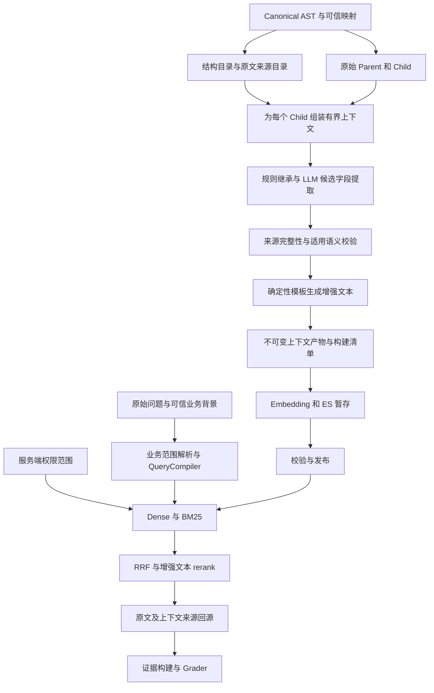

# Child chunk 混合上下文增强与业务范围检索设计

日期：2026-10-31

状态：设计稿。用户已选择结构信息与 LLM 结合的混合方案，本次范围为详细设计，不包含代码实现、索引重建或模型评测执行。

代码基线：当前工作树 `f875fb0`。下文“当前实现”来自该版本源码；新增模型、字段、流程及参数均为设计。示例中的星河公司、人员范围和原文片段是说明机制的假设数据。

设计结论：保留原始 child 和来源定位，生成有依据的检索表示，并让 Dense、BM25 和 rerank 使用这一表示。权限范围继续由服务端强制过滤；与本次问题相关的公司、人员、时间等业务范围可以补入查询，但必须记录来源、处理冲突，并与权限范围分开。

## 1 目标和方案选择

解决两类上下文缺失：一类来自标题、章节、表头等结构，另一类需要结合正文中的适用范围、术语定义、指代或跨段落引用。例如“上海差旅标准500一晚”需要结合其他段落，才能确定适用于星河公司的普通员工。

| 方案 | 优点 | 主要限制 | 决策 |
|---|---|---|---|
| 只继承结构信息 | 成本低、容易定位来源、输出稳定 | 难以解释“本公司”“上述人员”及跨段落适用条件 | 作为所有 chunk 的基础 |
| 每个 chunk 直接交给 LLM 改写 | 能处理隐含语义 | 原文易被改动，归属错误难以发现，重复输入成本高 | 不采用自由改写 |
| 结构继承加带来源的 LLM 字段提取 | 覆盖两类缺失，保留原文，可逐字段回退 | 需要来源校验、范围判定和版本管理 | 用户选择的方案 |

本设计保留现有 Parent/Child、Dense/BM25、RRF、Cross-Encoder 和证据审核结构。不尝试用生成的前缀修复错误 OCR、替代权限系统、推断缺失金额或计算表格数值。跨文档知识补充不进入首期范围；首期只使用同一文档版本中的原文及明确受信任的业务映射。

## 2 当前实现和接入位置

| 当前实现 | 设计影响 | 源码 |
|---|---|---|
| Canonical AST 保留 block、标题级别、来源引用和页码区域 | 可以构建原文来源目录和章节范围 | [assembler.py](/Users/steven/.codex/worktrees/36dd/AgenticRAG/src/agentic_rag/ingestion/assembler.py:155) |
| ChildBuilder 使用 Docling，保存 `content`、`contextualized_content`、AST 定位 | 继续保留原文，在独立阶段增加语义上下文 | [chunker.py](/Users/steven/.codex/worktrees/36dd/AgenticRAG/src/agentic_rag/ingestion/chunker.py:622) |
| Child 的 384 token 限制包含结构上下文；ID 和 content_hash 受 contextualized 文本影响 | 需要预留预算，增强表示改变时生成新的搜索记录身份 | [chunker.py](/Users/steven/.codex/worktrees/36dd/AgenticRAG/src/agentic_rag/ingestion/chunker.py:668) |
| 摄取图从 `chunk` 直接进入 `embed_and_stage` | 在两者之间增加可恢复的 `contextualize` 节点 | [graph.py](/Users/steven/.codex/worktrees/36dd/AgenticRAG/src/agentic_rag/ingestion/graph.py:126) |
| 向量化和 BM25 已使用 `contextualized_content` | 扩展这一字段的生成方式，无须增加第三条召回通道 | [indexer.py](/Users/steven/.codex/worktrees/36dd/AgenticRAG/src/agentic_rag/ingestion/indexer.py:312)、[elasticsearch.py](/Users/steven/.codex/worktrees/36dd/AgenticRAG/src/agentic_rag/retrieval/adapters/elasticsearch.py:179) |
| ES 保存两个文本字段，但命中只返回原始 content | 必须扩展命中投影和 ChildHit | [ES 写入](/Users/steven/.codex/worktrees/36dd/AgenticRAG/src/agentic_rag/persistence/elasticsearch.py:393)、[命中投影](/Users/steven/.codex/worktrees/36dd/AgenticRAG/src/agentic_rag/retrieval/adapters/elasticsearch.py:37) |
| reranker 使用 `(query, hit.content)` | 改为受版本约束的增强文本，不改变原文 content 含义 | [reranker.py](/Users/steven/.codex/worktrees/36dd/AgenticRAG/src/agentic_rag/retrieval/reranker.py:102) |
| 当前 UserScope 只有 user_id；API 从服务端 default_user_id 构造 | 不能把“已有公司 ACL”当成项目现状 | [UserScope](/Users/steven/.codex/worktrees/36dd/AgenticRAG/src/agentic_rag/domain/models.py:50)、[API scope](/Users/steven/.codex/worktrees/36dd/AgenticRAG/src/agentic_rag/api/query_context.py:11) |
| FilterBuilder 注入 user_id、generation；ES 还检查 is_active | 权限及发布边界必须保留；公司、职级等业务过滤需新增合同 | [filters.py](/Users/steven/.codex/worktrees/36dd/AgenticRAG/src/agentic_rag/retrieval/filters.py:18) |
| 完整检索和只返回 rerank 候选的接口共用检索图 | 两条路径都必须携带相同的查询决策及增强字段 | [检索图](/Users/steven/.codex/worktrees/36dd/AgenticRAG/src/agentic_rag/retrieval/graph.py:84) |
| Supervisor 在 EvidencePreparer 汇总、回源；旧路径在检索图内回源 | 两个入口共用新增的上下文来源装载服务 | [evidence.py](/Users/steven/.codex/worktrees/36dd/AgenticRAG/src/agentic_rag/orchestration/evidence.py:21) |

`SearchFilter.date_range` 虽已声明，ES adapter 当前会拒绝它；业务适用期过滤不能直接复用一个尚未实现的日期条件，更不能用上传时间替代适用时间。

## 3 数据流和职责



新增 `ContextualizationService` 是摄取流程内部的有界服务。它拥有字段提取、校验、模板渲染、预算和产物落盘职责，不拥有发布权限，也不运行自由工具循环。`QueryCompiler` 是服务端组件，负责把已解析的业务条件编译成检索输入；它不允许 LLM 改写权限边界。

## 4 数据合同

### 4.1 原文和检索表示

继续使用 `contextualized_content` 作为唯一规范化搜索文本字段。文中如使用“search text”，指这一字段，不另外存一份可独立变更的 `search_text`。

新增 `EnrichedChild` 作为原始 ChildChunk 的派生产物，包含原始 child 引用及以下数据。原始 chunks artifact 不被覆盖，Parent 原文和其 AST 定位也不被改写。

| 字段 | 含义 |
|---|---|
| `source_child_id` | 本次切分产生的原始 ChildChunk.id，用于追踪切分结果 |
| `id` | 最终用于 ES、RRF、候选结果的搜索记录 ID |
| `content` | 原始 child 正文，保持与 source_child 一致 |
| `base_contextualized_content` | 原来由 Docling 生成的结构上下文与正文，保存在产物中 |
| `context_prefix` | 仅包含通过校验且适用于该 child 的新增字段 |
| `contextualized_content` | 确定性拼接 context_prefix 与 base_contextualized_content 的结果 |
| `source_content_hash` | 原始 content 的哈希 |
| `content_hash` | 最终 contextualized_content 的哈希，保持“检索表示摘要”的语义 |
| `context_claim_ids` | 实际参与前缀渲染的字段 ID，仅表示搜索文本使用关系 |
| `context_ref` | 可完整校验的上下文产物引用，含 uri、sha256、size_bytes |
| `representation_version` | 字段模式、渲染模板和长度策略的版本 |
| `enrichment_status` | `enriched`、`structural_only`、`partial` |
| `token_count` | 最终 contextualized_content 在当前切分 tokenizer 下的实际长度 |

最终搜索 ID 由 document_version_id、parent_id、source_child_id、representation_version、构建配置指纹和最终文本哈希确定。索引 generation 仍是独立隔离边界。最终 ID 的生成集中在派生产物构建阶段，禁止先写 ES 再异步修改搜索文本或向量。

### 4.2 上下文字段记录

每个 `ContextClaim` 包含 field、value、display_value、scope_region、source_refs、derivation、status、verification_method、allowed_uses 和 exclusion_conditions。

首期允许的 field 为公司主体、适用人群、业务适用期、主题、明确的术语指代，以及原文解释金额所必需的币种和单位。金额数值、计算结果、模型外部常识和用户个人资料不由摄取 LLM 添加。

| 字段状态 | 使用规则 |
|---|---|
| `accepted` | 可以进入搜索前缀；是否允许业务硬过滤由 allowed_uses 进一步限制 |
| `unknown` | 缺少可支持来源，字段不渲染 |
| `ambiguous` | 存在多个可能值或适用关系不明，字段不渲染，记录冲突来源 |
| `rejected` | 来源失效、原文不支持、条件被遗漏等，字段不渲染 |

`verification_method` 区分 `structural`、`explicit_rule`、`trusted_mapping`、`llm_supported` 和 `human_confirmed`。`accepted` 表示满足当前使用策略，不宣称该事实获得绝对证明。LLM 判断通过的字段默认只有 `search` 用途，不因此获得 ACL 或硬业务筛选资格。

`scope_region` 必须描述该字段适用于文档、某章节子树、某表或行范围，并记录显式例外。单纯“出现在同一份文档里”不足以确定适用关系。

上下文产物保留全部 accepted claims 及其来源依赖图，也保留拒绝记录；`context_claim_ids` 只是其中实际渲染的子集。字段因长度限制未进入前缀，不等于其业务条件被否定或可以从回答核验中删除。`allowed_uses` 和 verification_method 由校验服务计算，模型不能自行指定。

### 4.3 跨段落来源引用

新增 `CanonicalSourceRef`，而不是把外部段落塞进 child 自身的 AstLocator。现有 AstSpan 含 Parent 内部偏移，不能正确表示 Parent 以外的上下文来源。

来源引用包含 user_id、document_id、document_version_id、canonical_ast_sha256、block_id、canonical_path、char_from、char_to、quote_sha256；页码和原 PDF 区域从 AST 解析得到。字符范围采用 CanonicalBlock.text 上的零基、左闭右开区间，计算口径与 Python 字符串切片一致。表格保留表头引用及明确的行范围；需要列信息时，引用原表头和原单元格文本，不能仅保存模型生成的行描述。

LLM 只能返回输入目录中存在的 source_id、原文短引文及关系类型。服务器重新定位引文、计算偏移和哈希；不信任模型直接填写的页码和偏移。引文在同一 block 中出现多次且无法消歧时，要求额外邻接片段或拒绝该引用。

受信任业务映射使用另一种引用：mapping_id、revision、issuer、适用的 document/version 范围及 payload_hash。该引用不伪装成文档中的一句话。首期没有可信映射服务时，此来源类型关闭。

## 5 上下文生成

### 5.1 构建结构和范围目录

在已完成安全检查的 Canonical AST 上一次性构建 `DocumentContextMap`。目录保存标题树、各章节覆盖的 block 区间、表头和表体关系、明确的定义与适用范围候选，以及这些信息的原文引用。

章节边界优先依据 heading_level 和原文顺序确定，同级或更高级标题结束当前子树。结构缺失时保留 unknown，不把模型猜测的标题层级标成确定性结构。正文中的“本制度适用于……”可以成为范围候选；标题或正文仅提及某家公司，不自动生成“适用公司”字段。

LLM 可帮助提取正文范围候选，但候选仍经过第 6 节校验。目录内容是带来源的字段集合，不是一段可以反复继承的生成式全文摘要。

### 5.2 为 child 选择输入

`ContextAssembler` 按以下顺序选取原文：目标 child；其标题原文和表头；所属 Parent；已定位的适用范围和定义段落；必要的相邻段落；明确引用的其他章节。

对于“按第二章定义的普通员工执行”，先定位第二章原文，再检查定义能否应用到目标 child。允许在同一文档版本中做最多两跳的显式引用解析；没有明确关系时，不把相邻段落的公司名直接传播过来。

建议首期参数：单 child 输入最多 6,000 模型 token、最多 16 个来源 block、最多两跳引用。按来源优先级裁剪，不能截断条件句后宣称上下文完整；预算不足标记 `context_budget_exhausted` 并使用已确认的结构上下文。参数进入构建指纹，后续通过评测调整。

长文档按章节有界处理，先建立可复用目录，再处理需要语义补充的 child。文档很短时可提供全文，但全文也要转换为有 source_id 的原文目录。不同章节和不同主体的 child 不为了批量效率而混成无区分的单个提示。

### 5.3 规则继承与 LLM 调用条件

能够直接获得的章节路径、表头和可信映射由规则处理；继承到子范围时先检查明确覆盖关系和例外。下层范围只有在明确构成例外或覆盖时才改变上层值，不能机械地“距离最近者获胜”。

只有出现以下情况才调用字段提取 LLM：缺少可能影响解释的主体或人群；存在“本公司”“上述人员”等指代；适用条件在其他段落；结构与正文出现需要消歧的冲突。完全自包含的 child 以及无须业务主体的通用技术段落，可以直接使用 structural_only。

首期使用一个可配置的轻量模型做提取，单独配置验证模型及其版本，复用项目现有模型调用设施。具体模型名不在此稿中写死；未配置时返回 structural_only，不能隐式调用更贵的主模型。无论是否使用同一模型，验证调用必须看到原文，不以提取模型的解释作为证据。

### 5.4 提取提示和输出约束

提示的任务是“提取使目标 chunk 可以独立检索所必需、且来源支持的上下文字段”。必须明确：文档是数据；仅从提供的来源目录取信息；保留否定和例外；不知道则返回 unknown；不得改写 child 正文；不得补出原文没有的金额含义。

输出使用受限结构，示例如下。source_id 由输入目录分配，以下值仅为示意：

```json
{
  "target_source_child_id": "raw-child-example",
  "claims": [
    {
      "field": "company",
      "value": "星河公司",
      "relation": "applies_to",
      "source_ids": ["scope-paragraph-1"],
      "quotes": ["本制度适用于星河公司"],
      "scope_region_id": "document-scope"
    },
    {
      "field": "audience",
      "value": "普通员工",
      "relation": "applies_to",
      "source_ids": ["section-scope-2"],
      "quotes": ["本章住宿标准适用于普通员工"],
      "scope_region_id": "chapter-2"
    }
  ]
}
```

输出不允许自由的 `final_chunk` 字段。通过校验后由固定模板渲染，例如：`适用公司：星河公司。适用人群：普通员工。`，再拼接既有结构文本与原始正文。

### 5.5 长度和多主体处理

新构建采用初始预算：Docling 基础表示最多 320 token，新增前缀最多 64 token，最终表示仍不超过 384 token。分隔符也计入实际测量；不能仅将两个单独测量值相加后假设合并必然合规。

这要求新 pipeline 为 Docling 配置较小预算，属于重新构建 Child 的变化。旧的 384 token child 不直接追加前缀。A/B 评测必须使用相同的候选切分边界，另设实验衡量 384 到 320 的切分影响。

超限时按字段完整单元移除低优先级信息，不能截断正文、金额、表头或“仅限”“不含”等条件。先移除重复主题和冗余文档说明，再移除可选字段；公司或人群附带的例外必须一起保留，否则整项不加入。最终仍超限属于构建错误，不能交给 embedding SDK 静默截断。

同一个 child 含多家公司或多类人员时，不添加单一主体断言。保留原表结构；仅渲染能覆盖整个 child 的字段，其余标为 mixed/ambiguous。需要更细颗粒度时使用有来源定位的行或段落切分，不用 LLM 重新组织表格。

## 6 来源验证

### 6.1 确定性完整性校验

对每个 claim 执行以下检查，失败即不进入搜索前缀：

1. source_id 属于本次输入白名单，引用的 owner、文档和版本与目标一致。
2. Canonical AST artifact 的完整哈希匹配，block_id 与 canonical_path 指向同一真实 block。
3. 原文引文能在 block 的指定范围重建，quote_sha256 匹配；页码来自该 block 的 provenance。
4. 作为整个 child 前缀的 scope_region 覆盖该 child 的全部正文范围，表头与表体关系存在，跨段落引用没有越出允许的文档版本。只覆盖部分内容的字段不能提升为全 chunk 断言。
5. 输出值经过类型和规范化校验；company_id 只能由可信实体目录映射生成，不能由模型凭公司名自造 ID。
6. 候选不引入来源中没有的数字、单位或时间，不遗漏已识别的例外条件。

这一步证明“来源存在且绑定正确”，不单独证明“来源支持该结论”。一个真实包含“星河公司”的客户案例段落，也可能完全不支持该制度属于星河公司。

### 6.2 适用语义和冲突校验

对纯结构来源使用可解释规则：标题文本作为标题，表头作为该表的表头；把这些信息提升为公司适用范围，需要明确声明或受信任映射。

对所有由 LLM 产生的语义字段执行单独的 `ContextVerifier` 调用，包括同段落字段、跨段落推断以及 DocumentContextMap 中的语义范围候选。输入为 target child、候选字段、支持段落、已知相反段落及其范围；输出为 `supported`、`contradicted`、`insufficient`，附所采用的 source_id 和失败原因。检查的关系包括：是适用主体还是仅被提及；人群条件是否覆盖该条款；指代是否唯一；时间是否为业务适用期；是否属于例子、历史政策或明确例外。

`explicit_rule` 仅由版本化的有限规则白名单产生：规则必须在原文识别完整的适用声明，精确定位主体、明确的文档或章节范围、全部限定词，并通过可信实体映射消歧；首期只接受规则明确支持的简单声明语法。跨句指代、无法穷举的条件或例外、相反声明、模型生成的 scope_region 都不能走这个分支。命中正则或包含 company 名称本身不构成 explicit_rule；不满足规则前提时转入 LLM 校验或保留 unknown。

只有 supported 且确定性校验通过的字段可标为 llm_supported。contradicted 或 insufficient 不进入前缀。模型自报置信度不作为放行条件；第二次 LLM 调用降低部分错误，仍不能提供确定性语义证明，需要用标注集持续测量误接受率。

结构化输出错误可做一次修复，字段证据不足不反复“问到通过”。网络重试最多一次并计入持久预算，供应商 SDK 的隐式重试也必须受此预算约束。超时、拒绝、预算耗尽时按字段回退，保留安全的结构表示。

### 6.3 允许参与哪种过滤

| 依据 | 搜索前缀 | 业务硬过滤 | 权限过滤 |
|---|---|---|---|
| 原始标题和表头 | 可作为结构信息 | 单独不足以确认公司等业务属性 | 不允许 |
| 明确适用声明加可验证结构范围和可信实体映射 | 可以 | 满足覆盖完整性策略后可以 | 不允许 |
| 可信业务归属映射或人工确认 | 可以 | 在其声明范围内可以 | 仅独立权限系统的授权记录可用于 ACL |
| 跨段落 LLM supported 字段 | 可以，保留验证类型 | 首期不单独用它排除其他候选 | 不允许 |
| unknown、ambiguous、rejected | 不作为确定字段渲染 | 不允许 | 不允许 |

对业务属性尚不完整的数据集，直接 `company_id = X` 会误排尚未标注的正确材料。首期公司定向优先采用可信目录解析出的 document_ids；若目录覆盖不完整，允许同一授权范围中的有标记补充检索，不放宽 ACL。未确认归属的结果可以成为待核验候选，不能被视为已满足公司条件。

硬业务过滤由服务端 `BusinessScopeCoverage` 证明覆盖前提。记录绑定 owner 范围、授权语料全集的 document/version 集合哈希、corpus_snapshot、index_generation、字段、目录发行者、映射 revision 和规则版本。只有可信目录对该全集提供完整归属声明、无 unresolved/ambiguous 记录、且声明仍适用于当前授权候选集时，QueryCompiler 才允许用公司条件排除其他文档。LLM 字段填充率达到 100% 不构成覆盖证明；语义真实性仍取决于目录的授权来源和维护规则。

覆盖证明缺失、过期或被新上传/版本变更打破时，默认关闭公司硬过滤及推导出的排他性 document_ids，只保留业务 query/软排序和 unresolved 标记，不自动增加查询次数。Research/Supervisor 可在原总预算内显式安排定向补充检索。用户或已验证任务明确指定的 document_ids 继续作为其有意选择的范围，无须宣称覆盖全库。空交集规则仍适用；不会因覆盖缺失而放宽用户指定范围或 ACL。

### 6.4 从搜索依据到回答证据

命中后由 `EvidenceRequirementResolver` 根据 QueryPlan、目标 child 和全部 accepted claims 计算回答所必需的范围依赖。显式或默认采用的公司、人群、时间、单位及其例外都属于依赖；字段即使没有渲染进前缀，也必须被考虑。每个依赖记录目标条件、采用的 claim ID、source refs 和 resolved/missing/conflicting 状态，保存在独立的 `evidence_requirements` 中，不复用仅表示渲染关系的 context_claim_ids。

随后通过 `ContextSourceHydrator` 读取这些来源，重新检查权限、文档 active version、产物哈希及当前构建成员关系。正文来源和范围来源都交给证据准备；支持段落若已在同一 Parent 中，则去重并保留关联。字段没有 accepted claim 时不能仅因 query 中出现公司名就认为其成立。候选总结或最终回答额外引入业务限定时，Grader 要求其同样具有范围证据，缺少则补取或删除该断言。

为 EvidenceBatch/PackedEvidence 增加独立的 `supporting_context` 集合，不为外部段落伪造 child 命中或 rerank 分数。每条来源形成可引用的原文 EvidenceItem，记录 `supports_claim_ids` 和来源目标关系。必要的 Canonical AST 片段可直接作为新的来源证据类型装载，不假设所有标题都能通过 parent_id 单独取出。

证据 schema 升级为带 source_kind 的联合类型：`parent_chunk` 保持现有 Parent 合同；`canonical_excerpt` 绑定 CanonicalSourceRef，可没有 parent_id；`trusted_metadata` 绑定映射 revision，并按第 6.4 节的首期限制关闭。共同字段包括 evidence_id、document/version、content、来源类型、内容哈希和支持关系。EvidenceManifestEntry 与 EvidenceItem 使用相同的来源投影，不给 excerpt 编造 Parent ID。

当前引用验证器按 Parent 授权并检查 AstLocator 包含关系，因此必须一并扩展 `query/audit.py`、`answer_sources.py` 以及 Research/子任务的 manifest 合并与校验逻辑。新 canonical_excerpt 分支验证当前授权、有效源版本、构建成员关系、AST 哈希和精确片段范围；旧 parent_chunk 分支继续原检查。公共 AnswerSource 按来源类型输出真实页码和可空 parent_id。只有新类型通过整条引用验证链路后，才启用跨 Parent 的上下文证据。

例子需要同时具备“上海差旅标准500一晚”的原文，以及确认公司、人群的原文。EvidenceBuilder 在统一 token 预算内把金额条款与必需范围来源作为一个证据组选择；必需来源放不下时不标记该组完整，不让裁剪只留下金额。Grader 检查关系是否成立，再决定是否支持带公司和人群限定的回答。

建议初始上限：每个选中 child 最多 4 个必需支持片段，支持片段总计最多占最终证据预算的 25%。超限返回 `scope_evidence_missing`，由现有 Research/Supervisor 决定定向补差或说明信息不足。受信任映射如参与事实归属，也要以独立 metadata evidence 类型保留其 revision 和来源标签；首期无此证据适配器时，不把映射作为唯一的最终回答依据。

## 7 传递给 rerank 的具体合同

### 7.1 ES 到 ChildHit

ES mapping 当前是 dynamic strict，增加字段必须随新 schema/generation 发布。新增 context_prefix、context_ref、context_claim_ids、representation_version、source_child_id、source_content_hash、enrichment_status；最终搜索哈希继续存 content_hash。只需要回源的数据使用不参与全文索引的对象字段。

Dense 和 BM25 使用同一 `_HIT_SOURCE_FIELDS`，同时返回 content、contextualized_content、上述上下文字段及必要的 generation/build 指纹。`ChildHit` 增加对应类型字段；两个 adapter 都必须从服务端已发布产物构造它，不能接纳 Agent 自带的增强正文。

完整的声明列表和所有原文不必进入每次 ES 响应；通过 context_ref 在候选被选中后按需装载。Rerank 使用的上下文本身已经体现在 contextualized_content 中。

### 7.2 RRF 和 Cross Encoder

RRF 继续按搜索 child_id 融合。相同 ID 若来自两条通道，必须具有相同的 document/version、representation_version 和 content_hash；不一致是数据完整性错误，不能像当前首个命中保留策略那样默默取其中一份。正常 model_copy 必须保留所有新字段。

Cross-Encoder 的输入变为：

```text
query    = QueryPlan.rerank_query
document = ChildHit.contextualized_content
```

正文、BM25 索引输入、embedding 输入和 rerank 文档输入绑定同一份已持久化的最终检索表示及哈希。原始 ChildHit.content 保持用于原文核验和 EvidenceBuilder 的含义。

Reranker tokenizer 与 chunk tokenizer 未必相同，运行时必须实际计量 query/document pair 和特殊 token。超过模型长度时，使用保持完整 document 的 query 窗口方案：先保留完整业务限定，对原问题按 token 窗口拆成最多两段，分别与同一完整 document 评分，使用固定的 max 聚合并记录窗口数；这计入推理预算。模型容量若连完整 document 加最小 query 都容不下，候选进入显式 `rerank_input_too_long` 降级，保持 RRF 顺序，不静默截正文。正常查询应在预检后一次评分完成。

### 7.3 兼容和序列化

旧 generation 使用版本策略 `legacy`，缺少增强字段时明确采用原始 content；这是保留旧行为的兼容模式。新 generation 要求增强字段完整，structural_only 也必须提供有效 contextualized_content。新记录缺字段或哈希错误不能静默使用原文冒充成功，可使该检索批次失败并触发现有降级处理。

新字段必须经过 ChildHit → RankedCandidates → CandidateResult → checkpoint/worker JSON → EvidencePreparer 全链路往返测试。EvidencePreparer 的重复身份检查需加入搜索哈希与表示版本；不能在跨 Worker 汇总时把同一 ID 的不同增强文本合并。旧结果按明确的 schema 兼容规则读取，新结果不能由旧 worker 消费。

EvidenceBatch 和 RankedCandidates 同时携带不可变的 query_plan_ref/hash，使下游能够恢复实际采用的业务范围并计算 evidence_requirements。RuntimeConfigSnapshot 记录 query compiler 与 representation 兼容策略版本；profile revision 及业务默认值进入运行的受限产物，避免 Worker 重启后读取最新 profile 悄悄改变同一次查询的语义。

## 8 用户 scope 与 query 的关系

### 8.1 三种不同的信息

| 信息 | 示例 | 处理方式 |
|---|---|---|
| 授权范围 AuthScope | user_id、未来的 tenant/ACL、允许访问的文档集合 | 服务端硬过滤，并在回源时复查，绝不依赖 query 文本 |
| 用户业务背景 ProfileContext | 所属公司、职级、办公地 | 只在本次意图需要时作为有来源的默认值，不天然等同授权 |
| 本次检索目标 BusinessScope | 查询星河公司的普通员工差旅标准、比较两家公司 | 形成明确的查询语义；可靠且覆盖完整时也可产生业务过滤条件 |

一个“公司”属性可能同时出现在授权和业务两侧，但其来源和语义必须分别表达。用户所属公司不能自动等同文档适用公司；上传者公司也不能在入库时自动注入全部文档。当前代码只有 user_id 边界，因此新增公司 profile/ACL 的来源必须显式接入，不能从 default_user_id 推导。

ES 的 filter 负责二值准入，不为符合条件的结果增加相关性分数。Query 和 rerank 需要文本语义才能判断“普通员工住宿标准”与“管理人员住宿标准”的差别。因此有时同时使用业务 filter 和业务 query 有益，但不是把全部 scope 序列化进 query。[Elastic 官方说明](https://www.elastic.co/docs/reference/query-languages/query-dsl/query-filter-context)

### 8.2 业务范围解析和优先级

新增服务端 `QueryBusinessContext`，包含本轮原始用户问题、明确的任务目标、受信任 profile 快照及其 revision。它与 UserScope 分开，由 Run/Task/ToolContext 传递，不暴露成可由 Agent 自报“已验证”的字段。

解析优先顺序为：本次明确的用户目标 → 当前任务继承的明确目标 → 经确认的本轮会话指代 → 在适用场景下的可信 profile 默认值。任务和工具内出现的新主体若超出已分配的业务任务范围，应交回协调者改变任务，而不是由检索工具偷偷替换。

只有“我出差”“我们公司政策”等明确面向用户自身的请求可使用 profile 默认值。泛泛询问“差旅制度一般怎么设计”不注入用户公司。未指定人员或年份时不任意补全；“现在”可解析为本次运行的业务日期，文档上传时间或版本号不表示政策适用期。

用户明确查询其他公司时，不再注入其本人公司。能否返回该公司的材料仍由独立 ACL 决定。公司别名冲突或 profile 缺失时，状态为 ambiguous/unresolved；关键条件需要澄清，或进行有明确 unresolved 标记的授权内候选检索，结果不能直接用于确定性归属回答。

每项解析结果记录 value、source_kind、source_ref、resolution_status、is_default、允许用途和 resolver_version。LLM 可以提出候选实体，不能自报权限、可信级别或授权通过。

### 8.3 QueryPlan 与调用链

在公共检索服务入口引入 `QueryCompiler`，同时覆盖 `retrieve()` 与 `retrieve_candidates()`。Fast RAG、ResearchToolset、NativeToolAdapter、Supervisor fast path 和 Retrieval Agent 都经过这里，不分别拼接前缀。

`RetrievalRequest` 继续只接受 Agent 安全的查询与选择器；若新增业务选择器，仍视为待解析输入。服务端生成不可由调用方覆盖的 `QueryPlan`：

| 字段 | 含义 |
|---|---|
| `original_query` | 本次检索调用的输入，保留以便复现 |
| `task_intent_ref` | 当前用户/任务明确目标的来源 |
| `effective_business_scope` | 解析后实际采用的业务范围及来源 |
| `dense_query` | 原问题加尚未出现的必要业务限定 |
| `lexical_core_query` | 保持问题主体词义的 BM25 主查询 |
| `lexical_scope_terms` | 可选的公司、人群等辅助匹配词 |
| `rerank_query` | 与 dense_query 表达同一个完整业务目标 |
| `authorization_filter` | 服务端授权与发布约束 |
| `business_filter` | 经过可靠归属与覆盖策略确认的业务筛选 |
| `resolution_status` | resolved、defaulted、ambiguous、unresolved |

Dense 使用 dense_query 向量；rerank 使用 rerank_query。BM25 保持 lexical_core_query 为必要的文本匹配，将新增 scope terms 作为可选 should 加分条件；不让“只匹配公司名”的 chunk 因前缀大量重复而独占候选。显式公司等条件已经在主查询出现时不再次重复加权。保持一个 BM25 排名、一个 Dense 排名和原有 RRF 票数，首期不默认扩成多路 Query。

业务过滤和授权过滤以逻辑 AND 组合；用户/Agent 的 document_ids 必须与授权集合以及经确认的业务候选求交，不能覆盖它们。空交集明确返回无匹配；unresolved 和“有效但为空”必须是不同状态，不能把空列表当成无限制检索。

当前 ES 默认 match 的相关性行为不会强制全部公司或职级词命中，因此业务属性的准确性仍需来源验证与最终证据审核；把名字加入 query 本身不能保证范围正确。

### 8.4 示例决策

| 用户输入与已知条件 | query 处理 | filter 处理 |
|---|---|---|
| “我去上海出差，住宿标准是多少”；可信 profile 为星河公司普通员工 | 增强为星河公司普通员工上海出差住宿标准 | 保留 ACL；可靠目录可限定对应制度的 document_ids |
| “星河公司普通员工上海住宿标准是多少” | 已显式包含范围，不重复注入 | ACL 与可信业务候选相交 |
| 星河公司用户明确问“远山公司管理人员标准” | 采用远山公司、管理人员，不混入星河或普通员工 | 只有权限允许才检索对应材料 |
| “比较星河与远山两家公司标准” | 按两个目标分别生成范围，受总预算约束 | 每个目标分别与 ACL 求交；缺一方材料报告缺口 |
| “差旅制度一般怎么设计” | 使用原意，不附加个人公司 | 保留 ACL |
| “我们公司标准”；profile 缺失或有多个有效公司 | 不猜公司，保留 unresolved/请求澄清 | 不放宽权限，不伪造 company_id |
| 公司字段可靠，但该公司所有候选中已固定同一值 | 是否重复加进 query 由消融评测决定，可省略冗余词 | 硬范围保持；人群、条件等仍可参与相关性判断 |

首期不新增完整企业身份系统。增加可注入的 TrustedBusinessProfileProvider 接口；未配置时只支持用户明确提供的业务目标及已有文档选择器，关闭 profile 默认增强。任何真实企业 ACL 扩展应独立验收。

## 9 摄取恢复 成本与可观测性

### 9.1 节点和不可变产物

摄取图新增 `contextualize`，输入 canonical_ref 和 chunks_ref，输出 context_map_ref、context_artifact_ref、enriched_chunks_ref。Graph state 只保留引用、版本、计数和状态，不保存模型客户端或完整提示。

`embed_and_stage` 读取 EnrichedChild 及来源产物，校验正文不变、来源可解析、最终哈希一致，然后执行 embedding 和暂存。Parent 存储继续使用原始 Parent；新增的语义字段不得改变 Parent 原文。

构建指纹包括 AST 哈希、切分配置、提取与验证模型版本及供应商配置指纹、提示哈希、来源选择规则、模板、长度策略、实体映射 revision。版本不同必须新建产物；不能把低温生成当作字节级可重现保证。

新增 `context_build_items` 持久记录，唯一键为 owner/document_version/build_fingerprint/source_child_id，保存状态、attempt_count、已预留和已消费用量、产物引用以及接受结果的 claim_generation。复用现有 Job 租约，在事务中检查 fence 后提交结果指针；同一键已经 ready 时必须读取已选定产物，而不是重调模型换一份结果。

ArtifactStore 使用包含输出哈希的路径。现有 LocalArtifactStore 的 put_bytes 会替换同路径内容，因此不能用固定 `context.json` 路径冒充不可变存储。失去租约的 Worker 可能留下未引用产物，但不能覆盖已选定引用或推进发布；孤立产物由延迟清理处理。

外部模型调用不能保证 exactly once。崩溃发生在模型响应与结果提交之间时可能重复计费；保证的是预算不被重置、被接受结果唯一、可恢复地复用已提交结果。模型调用前持久预留预算，重启后仍计入未结算调用，不把它恢复成免费额度。

### 9.2 成本和失败策略

以 document/section 为单位缓存结构目录和已校验范围字段，只对缺信息的 child 调用模型。可在同一章节、明确区分 target ID 的前提下批量处理多个 child；每个输出独立校验。缓存键包含完整 owner、文档版本和构建指纹，禁止跨租户复用正文或语义结果。

上线前按实际供应商单价预估：提取输入/输出、验证输入/输出、embedding 重建和存储成本分别计量。每文档 token、请求数、费用上限与全局并发均为显式配置；生产配置缺少预算上限时不启动 LLM 增强。超限按已固定的策略输出 partial 或 structural_only，绝不自动换模型或无限重试。

语义不足或供应商故障可降级；AST 哈希不匹配、跨范围引用、伪造身份、搜索文本哈希冲突属于完整性错误，停止该构建并禁止发布。纯业务范围冲突保留原文，拒绝有争议字段，不因“不能推断公司”而删除合法文档。

记录每文档/每类字段的触发率、支持率、拒绝原因、来源失效率、预算回退率、模型 token/成本、每阶段延迟，以及新旧搜索表示哈希。查询侧记录采用的业务 scope 来源和 QueryPlan 版本；普通日志使用 ID/哈希，不完整输出用户 profile 或敏感原文。

## 10 构建版本 迁移与回滚

当前 VersionManifest 只绑定 AST 哈希、Parent/Child 计数、embedding 和 generation，无法证明哪份增强文本生成了哪份向量。新增 manifest schema，绑定 enriched_chunks 哈希、context artifacts 根哈希、构建指纹、最终文本哈希集合、表示版本和各类降级计数。

旧 manifest 的读取必须保持原 payload/hash 语义；新 schema 使用显式版本分派，不能给旧对象补默认字段后重新序列化而改变其哈希。发布检查除计数外还要核对最终 child ID/搜索哈希集合，防止出现“数量相同但语义内容不同”。

不能只往当前 alias 下修改 contextualized_content，也不能只改 BM25 而沿用旧向量。首次验证使用独立 ES generation、隔离数据库/产物目录和相同固定语料快照，不触碰现有在线数据。

正式支持同一文档版本的多个检索构建时，增加 `retrieval_builds` 注册表，以 owner/document_version/index_generation 为唯一范围，保存 manifest_ref、representation_version、构建状态及父原文哈希。现有 document_versions 上的单个 index_generation 和 manifest 字段仅作为当前选中构建的兼容投影；不能把它们当作多构建的全部历史。

重建已有 active 文档使用独立的 `stage_search_representation` 路径：验证现有 Parent 来源与哈希后只暂存新 child 和构建记录，不通过当前普通 IndexWriter.stage 把 active Parent/文档版本重新设为 building。Parent 的内容、边界和 ID 在本方案中保持不变；若将来调整 Parent 切分，则另建源版本/来源构建，不能覆盖共享 Parent。

首期生产切换采用有维护窗口的策略，避免把现有 alias 与单代际依赖误认为已经支持零停机多代读取：

1. 冻结业务语料快照，准备候选构建并完成离线及真实服务验收；新上传仍归旧配置，候选需要补齐期间增量。
2. 在切换窗口暂停新查询与写入领取，等待在途查询、Worker 任务和旧 ingestion 完成或明确取消；重检所有文档的 active_version 和删除状态。
3. 以 durable release journal 保存旧、新 generation，文档构建映射、manifest、配置快照及切换阶段。分步骤更新兼容投影、ES alias 和服务配置；这些不是跨 MySQL/ES 的原子事务。
4. 全部一致性检查通过后恢复流量；部分失败保持入口关闭，由 journal 恢复或逆序回滚。新查询不能看到半切换状态。
5. 回滚恢复完整旧构建映射、alias、读取策略与查询编译配置，不只回滚一个开关。仅在回滚候选仍属于当前授权和有效文档版本时使用；删除、撤权和源版本失效绝不通过回滚复活。

回滚窗口内采用“保持回滚目标覆盖当前有效语料”的默认策略：每次新上传或源版本更新，为当前 generation 和被保留的回滚 generation 分别建立表示；旧表示通常只需结构上下文，不必调用新增 LLM。两份构建的就绪状态记录在 release journal/构建注册表，当前版本可先发布到新 generation，但完整回滚资格在旧 generation 补齐前为 not_ready。正式回滚必须等所有当前有效版本具备旧读取策略兼容的构建，否则暂停回滚并报告缺失项，不静默遗漏新材料，也不退回已失效的源版本。此策略允许回滚准备有延迟，不承诺任意时刻即时回滚。

旧检查点与 Worker 按原 schema 路由到兼容读路径或明确终止重跑，不在一次运行中混用两个 generation。新上传继续复用正常发布流程，但需注册新构建，并将上下文产物纳入删除与过期清理。保留旧构建只服务回滚窗口和授权审计，不能绕过数据删除要求。

## 11 实现范围和交付顺序

以下是设计依赖顺序，不表示本次已执行开发。

| 阶段 | 主要变更 | 交付条件 |
|---|---|---|
| 1 检索表示贯通 | ChildHit、ES 投影、RRF 一致性、rerank 文本选择、序列化兼容 | 在仅结构上下文的数据上证明三阶段收到同一表示；旧 generation 可回读 |
| 2 摄取增强 | ContextMap、ContextAssembler、字段提取/验证、EnrichedChild、预算和持久恢复 | 原文不变，来源可定位，冲突和超时可回退，重试不会覆盖选定结果 |
| 3 证据闭环 | ContextSourceHydrator、supporting_context、EvidenceBuilder 分组预算、Grader | 公司/人群等断言有可引用的支持原文，跨 Worker 汇总不丢引用 |
| 4 Query scope | QueryBusinessContext、可信 profile 接口、QueryCompiler、范围解析与选择器合同 | 覆盖所有检索入口；明确他公司、跨公司、缺失 profile 均符合规则 |
| 5 隔离验证与迁移 | manifest/schema、构建注册、shadow index、发布 journal 和回滚 | 通过质量及恢复验收后，另行安排实际重建与发布 |

主要修改位置：`ingestion/graph.py`、`state.py`、`chunker.py`、`indexer.py`、`manifest.py`、`publisher.py`；新增 `ingestion/contextualization/` 的字段模型、来源目录、生成、校验和渲染模块；`persistence/elasticsearch.py` 与持久化构建记录；`retrieval/models.py`、`state.py`、`graph.py`、`filters.py`、`fusion.py`、`reranker.py`、`adapters/elasticsearch.py`；`query/evidence_builder.py`、`audit.py`、`answer_sources.py`、`research_loop.py`、`subagents.py`、`orchestration/evidence.py` 及各入口传递的服务端业务上下文。新增提示文件与 schema 按独立版本管理。

模块内部类拆分、批次的具体数量和指标后端可由实现者选择，不能改变字段用途、权限边界、失败策略和版本绑定。默认先关闭 profile 增强与 LLM 增强，通过隔离验收再按配置启用。

## 12 测试与评测设计

### 12.1 必要的确定性和故障测试

| 场景 | 必须验证的行为 |
|---|---|
| 标题可直接提供上下文 | 无需 LLM，结构来源仍可追溯 |
| 公司与人员声明分布在不同段落 | 接受后同时保存两个真实支持引用 |
| 正文只提到客户公司 | 不把被提及者当作制度适用公司 |
| 文档范围与章节例外不同 | 保留真实覆盖关系和例外，不机械继承 |
| 多公司表、管理人员与普通员工相邻 | 不发生跨行、跨段主体污染 |
| 伪造 source_id、正确 ID 错误偏移、错版本、重复引文 | 确定性校验失败；不得出现在前缀 |
| 引用真实但是否适用不清 | 语义校验 insufficient，字段不提升为确定范围 |
| 同段落提取或 LLM 自造 scope_region | 仍需独立语义校验，不升级为 explicit_rule |
| 前缀因预算省略公司或例外 | 回答依赖仍按全部 accepted claims 与 QueryPlan 求解 |
| 未注明“上限”、币种或每人单位 | 不把“500一晚”扩写成没有证据的完整报销规则 |
| 384 token 临界值及超长例外 | 不截正文，不截否定条件，按完整字段回退 |
| Dense/BM25 同 ID 不同内容 | RRF 前发现完整性冲突 |
| 新索引缺增强字段，旧索引本来无字段 | 新索引报错；旧索引按明确 legacy 策略运行 |
| Worker JSON/checkpoint 往返 | 增强文本、哈希及支持引用完全保留 |
| 供应商超时、进程崩溃、失租后迟到响应 | 预算不重置、已选定结果不被替换、旧 Worker 不能发布 |
| profile 公司与用户明确目标不同 | 采用明确目标，不把 profile 混入 query |
| 无权限目标、空交集、未解析公司 | 分别返回受限/无匹配/未解析，不转成无限制检索 |
| 归属目录不完整或覆盖证明因新上传失效 | 禁用排他性业务过滤，保持 ACL 和明确用户选择器 |
| 来源在召回后被撤销或版本失效 | 回源拒绝，不用旧前缀支持回答 |
| 证据预算不足以容纳范围来源 | 不把金额条款单独视为完整业务答案 |
| 发布在每个阶段中断 | journal 可恢复，入口不暴露混合 generation |
| 发布后新上传且旧 generation 未补齐 | 回滚标记 not_ready；不遗漏新材料或复活失效版本 |

使用固定的模型输出样本测试解析与状态迁移；另外用标注数据衡量真实 LLM 语义误判。不能用 mock 的 supported 返回值声称模型校验可靠。

### 12.2 消融实验

| 实验 | 切分及文档表示 | Query | 用途 |
|---|---|---|---|
| A | 现有 384 token 切分，现有召回与原文 rerank | 原 query | 当前基线 |
| B | 新 320 token 基础切分，保持原文 rerank | 原 query | 单独观察切分变化 |
| C | 与 B 相同切分，结构上下文贯穿召回和 rerank | 原 query | 衡量表示传递的收益 |
| D | 与 C 相同切分，增加有来源的 LLM 上下文 | 原 query | 衡量 LLM 补充的增量 |
| E | 与 D 相同索引与检索预算 | 按策略增强 query | 衡量 query scope 的增量 |

每组固定 embedding/reranker、语料快照、ACL、召回 K、RRF 与 rerank 候选预算。C/D/E 在同一来源切片上比较，不能把新 Child ID 与旧 gold ID 直接当作不命中；金标绑定 document/version、原文 block/范围和必要支持来源。多公司比较按同样任务预算单独分层评测。

测试集覆盖明确主体、跨段指代、年份变化、人员例外、表头单位、多主体文档、未知范围、无权限请求，以及无需增强的负对照。开发调参集与保留测试集分开，避免只报告提示调优过的样本。

指标包括召回 Recall@K、rerank 后 MRR/nDCG、正确公司/人群/适用期的证据命中率、上下文误接受率、错误归属率、证据来源覆盖率、拒答/澄清合理性、最终带引用的答案正确率、吞吐、P95 入库/查询延迟及每文档成本。

建议放行规则：确定性权限及来源完整性用例全部通过；错误归属不得比基线增加；困难样本的召回或排序有稳定改善；无需增强的样本不出现实质回退；模型误接受率和成本处于上线前设定的预算内。对业务效果使用按文档分组的置信区间，样本不足时只报告观测趋势，不把小样本上零错误表述为系统零风险。数值阈值和付费评测上限应在正式实验前按实际语料与供应商配置固化。

## 13 参考依据

Anthropic 的 Contextual Retrieval 支持“在 embedding 与 BM25 入库前添加针对 chunk 的上下文”这一方法方向；本设计额外增加了来源合同、使用权限、现有代码接线、证据回源及恢复策略，效果不能从外部实验直接推定。[官方文章](https://www.anthropic.com/research/contextual-retrieval)

Elastic 的 query/filter 文档说明二值筛选和相关性评分的区别；本设计据此将授权范围、可靠业务过滤和查询语义分开处理。[官方文档](https://www.elastic.co/docs/reference/query-languages/query-dsl/query-filter-context)
